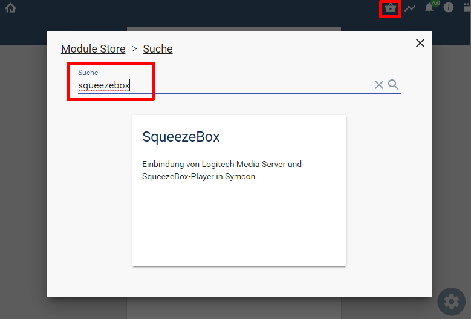

  

   

# Symcon-Modul: SqueezeBox  <!-- omit in toc -->  

Ermöglicht die Steuerung sowie die Darstellung der Zustände
von SqueezeBox Geräten in IPS, in Verbindung mit dem
Lyrion Music Server.

## Inhaltsverzeichnis <!-- omit in toc -->

- [1. Funktionsumfang](#1-funktionsumfang)
  - [Discovery:](#discovery)
  - [Squeezebox Konfigurator:](#squeezebox-konfigurator)
  - [Lyrion Music Server:](#lyrion-music-server)
  - [SqueezeBox Player:](#squeezebox-player)
  - [Squeezebox Alarm (Wecker):](#squeezebox-alarm-wecker)
  - [Squeezebox Battery:](#squeezebox-battery)
- [2. Voraussetzungen](#2-voraussetzungen)
- [3. Software-Installation](#3-software-installation)
- [4. Einrichten der Instanzen in IP-Symcon](#4-einrichten-der-instanzen-in-ip-symcon)
- [5. Anhang](#5-anhang)
  - [1. GUID der Module](#1-guid-der-module)
  - [2. Datenaustausch](#2-datenaustausch)
  - [3. Changelog](#3-changelog)
  - [4. Spenden](#4-spenden)
- [6. Lizenz](#6-lizenz)

## 1. Funktionsumfang

### [Discovery:](LMSDiscovery/)  

- Einfaches Auffinden von Lyrion Music Servern im lokalen Netzwerk.  
- Einfaches Einrichten von Konfiguratoren für gefundene Server.  

### [Squeezebox Konfigurator:](LMSConfigurator/)  

- Auslesen und darstellen aller im LMS und IPS bekannten Geräte und Instanzen.  
- Einfaches Anlegen von neuen Instanzen in IPS.  

### [Lyrion Music Server:](LMSSplitter/)  

- Auslesen un darstellen von Server-Informationen.  
- Auslesen von Datenbank Informationen.  
- Auslesen und bearbeiten von Server-Playlisten.  
- Laden von Server-Playlisten über das WebFront in einen (mehrere) Player.  
- Steuern des Scanner der Datenbank inkl. Darstellung des laufenden Modi vom Scanner.  

### [SqueezeBox Player:](SqueezeBoxDevice/)  

- Steuern und Abfragen der diversen verschiedenen Zustände und Eigenschaften.  
- Abfragen, Laden, bearbeiten und speichern von der internen Playlist des Gerätes.  
- Synchronisierung steuern.  
- Fähigkeiten über das WebFront:  
  - Modus: Play,Pause, Stop
  - Audio: Lautstärke mit Stummschaltung, und wenn vom Gerät unterstützt, auch Tonhöhe sowie Höhen und Bass.
  - Bedienung der 6 Preset-Tasten vom Gerät
  - Sleeptimer: Setzen und löschen des Timer.
  - Playlist: Trackwahl, nächster, vorheriger Track, Wiederholung und Zufallsmodus
  - Darstellung der Daten zum aktuellen Track: Titel, Album, Interpret, Stilrichtung, Cover etc..
  - Darstellen der Server-Playlisten sowie laden derselben auf Player.

### [Squeezebox Alarm (Wecker):](SqueezeBoxAlarm/)  

- Auslesen und darstellen der Wecker einer Squeezebox.
- Steuern der Wecker über das WebFront und PHP-Befehlen.

### [Squeezebox Battery:](SqueezeBoxDeviceBattery/)  

- Auslesen und darstellen von Werten der Stromversorgung und des Akkumulators.  

## 2. Voraussetzungen

- Symcon ab Version 8.2
- Lyrion Music Server
- kompatible Player

## 3. Software-Installation

Über den 'Module-Store' in IPS das Modul 'SqueezeBox' hinzufügen.  
**Bei kommerzieller Nutzung (z.B. als Errichter oder Integrator) wenden Sie sich bitte an den Autor.**  
  

## 4. Einrichten der Instanzen in IP-Symcon

Nach der Installation über den 'Modul-Store' fragt Symcon ob die enthaltende [Discovery Instanz](LMSDiscovery/) erstellt werden soll.  
Werden Symcon und der `Lyrion Music Server` allerdings nicht im gleichen physikalischen Netzwerk betrieben, wie z.B. Symcon hinter einer NAT, so kann diese Frage verneint werden.  
Der [Squeezebox Konfigurator](LMSConfigurator/) muss in dieser Konstellation per Hand angelegt und sein dazugehöriger [LMS Splitter](LMSSplitter/) manuell konfiguriert werden.  

Die Einrichtung der Instanzen ist direkt in der Dokumentation der jeweiligen Module beschrieben.  

## 5. Anhang

### 1. GUID der Module

| Modul                            | Typ          | Prefix | GUID                                   |
| :------------------------------- | :----------- | :----: | :------------------------------------- |
| Lyrion Music Server Discovery    | Discovery    |  LMS   | {28AC8A6C-4E03-43BE-9C3E-B8FEF78D374C} |
| Lyrion Music Server              | Splitter     |  LMS   | {96A9AB3A-2538-42C5-A130-FC34205A706A} |
| Lyrion Music Server Configurator | Configurator |  LMC   | {35028918-3F9C-4524-9FB4-DBAF429C6E18} |
| Squeezebox                       | Device       |  LSQ   | {118189F9-DC7E-4DF4-80E1-9A4DF0882DD7} |
| Squeezebox Alarm                 | Device       |  LSA   | {E7423083-3502-42C8-B244-2852D0BE41D4} |
| Squeezebox Battery               | Device       |  LSQB  | {718158BB-B247-4A71-9440-9C2FF1378752} |

### 2. Datenaustausch

| Funktion                | GUID                                   |
| :---------------------- | :------------------------------------- |
| von Splitter zu Devices | {CB5950B3-593C-4126-9F0F-8655A3944419} |
| von Devices zu Splitter | {EDDCCB34-E194-434D-93AD-FFDF1B56EF38} |

Der Datenaustausch erfolgt mit einem Objekt vom Typ `LMSData`:  

| Eigenschaft |  Typ   | Funktion                      |
| :---------- | :----: | :---------------------------- |
| Address     | string | MAC / IP-Adresse oder leer    |
| Command     | array  | CLI Kommandos als Array       |
| Data        | array  | Daten des Kommandos als Array |

### 3. Changelog

**Nächste Version (in Vorbereitung):**  

> [!IMPORTANT]
> Geändertes Fehlerverhalten, bitte eigene Skripte prüfen:
>
> - Fehlermeldungen der Instanz-Funktionen (`LMS_…`, `LSQ_…`, `LSA_…`, `LSQB_…`) werden nicht mehr zusätzlich per `echo` ausgegeben. Die Funktion erzeugt nur noch einen Hinweis (Notice) mit der Meldung und liefert `false`. Das aufrufende Skript läuft weiter. Bisher erschien die Meldung doppelt.

**Geändertes Verhalten**  

- Bedienung über Statusvariablen: Eine Fehlermeldung erscheint nur noch einmal. „Fehler beim Ausführen der Aktion“ erscheint nur noch, wenn keine genauere Meldung vorliegt.  
- Splitter: Beim Laden einer Playlist bzw. eines Favoriten auf die ausgewählten Player synchronisiert der Splitter die Player selbst über den LMS.  
- Player: Tritt ein Player einer Sync-Gruppe bei (auch über die LMS-Oberfläche oder eine App), übernimmt seine Instanz den Sync-Zustand und die Playlist.  
- `LSQ_GetPlaylistURL` meldet, wenn die aktuelle Playlist keine gespeicherte Playlist ist.  
- Verzögerte Aktualisierungen (Sync-Anzeige der Player, Player-Liste im Splitter) starten keinen eigenen Skript-Thread mehr.  
- Die Meldung „Migrated settings“ erscheint nicht mehr bei jedem Start im Log.  
- Batterie: Ist die Squeezebox nicht erreichbar oder schlägt die Anmeldung fehl, zeigt die Instanz den neuen Status `201`. Die zyklische Abfrage schreibt den Fehler nur noch beim ersten Fehlschlag ins Log; Meldungen der SSH-Bibliothek erscheinen nur noch im Debug.  
- Player: Cover, Playlist-Markierung und Titeldaten werden je Titelwechsel nur noch einmal geladen (bisher bis zu viermal).  

**Behobene falsche Werte in Statusvariablen**  

- Wecker: Die Wiederholung zeigte „Playlist“ statt „An“. Die Auswahl ist jetzt „Aus“ / „An“.  
- Player: Seit 4.10 wurde die Variable „Ausschalten in“ (Ident `SleepTimeout`) in „SleepTimeout (old)“ umbenannt, wenn noch die alte Variable aus Version 4.05 vorhanden war. Das passiert nicht mehr; bereits umbenannte Variablen bitte selbst zurückbenennen.  

**Fehlerbehebungen**  

- Fehlende deutsche Übersetzungen von Meldungen und Formularen ergänzt.  
- Splitter: Gleichzeitige Anfragen (z.B. aus zwei geöffneten Konfiguratoren) konnten die Antwort einer anderen Anfrage erhalten oder mit „Keine Antwort vom LMS“ abbrechen.  

**Version 4.11:**  

> [!IMPORTANT]
> Geänderte Rückgabewerte und geändertes Verhalten, bitte eigene Skripte prüfen:
>
> - `LSQ_GetSync` liefert im Fehlerfall `false` statt eines Arrays. Player ohne Instanz in Symcon sind nicht mehr als `false` im Array enthalten.
> - `LSQ_GetSongInfoByTrackIndex` bricht bei einem ungültigen Index das Skript nicht mehr mit einer Exception ab, sondern erzeugt einen Hinweis und liefert `false`.
> - `LMS_DeletePlaylist` liefert `true`, sobald der Befehl gesendet wurde. Der LMS bestätigt das Löschen nicht.
> - `LMS_GetGenresEx`, `LMS_GetArtistsEx`, `LMS_GetAlbumsEx` und `LMS_GetPlaylistsEx` liefern ohne Treffer ein leeres Array statt `false`.
> - URLs in den Rückgabewerten (z.B. von `LMS_GetFavorites`, `LMS_GetDirectoryByID` oder den Songinfos) behalten ihre Kodierung, z.B. `%20` statt eines Leerzeichens. Sie können unverändert an andere Funktionen übergeben werden.
> - Die Auswahl `Standby` der Variable `Scanner` sendet keinen Befehl mehr und setzt die Anzeige nicht zurück.

**Behobene falsche Werte in Statusvariablen**  

- Player: Die Lautstärke wurde bei der Statusabfrage nie gelesen.  
- Player: Beim Leeren der Playlist wurden `Position` und `Position als Text` nicht zurückgesetzt.  
- Player: Bei Streams ohne Laufzeit wurde eine Position angezeigt und der Fortschritt war teilweise bedienbar. Position und Fortschritt stehen bei Streams jetzt auf 0 und sind nicht bedienbar.  
- Player: JSON- und HTML-Playlist wurden nicht aktualisiert, wenn sich die Anzahl der Titel nicht änderte (z.B. Wechsel von einem Stream auf einen Favoriten oder Verschieben eines Titels).  
- Player: `Playlistname` behielt den Namen der zuletzt geladenen gespeicherten Playlist, auch wenn danach z.B. ein Stream lief.  
- Wecker: Beim Löschen eines oder aller Wecker wurden Variablen und Ereignisse teilweise nicht zurückgesetzt bzw. gelöscht.  
- Wecker: Wecker mit rein numerischer Id wurden nicht aktualisiert.  
- Spielzeiten von genau einer Stunde wurden als `00:00` angezeigt.  

**Fehlerbehebungen**  

- Batterie: Die Abfrage brach mit einem Fehler ab, bei falschem Passwort wurden alle Werte auf 0 gesetzt.  
- Splitter: Bei falschem Benutzernamen oder Passwort meldete der Splitter `Keine Antwort vom LMS` statt eines Anmeldefehlers.  
- Das Passwort für den LMS erschien im Klartext in den Debug-Ausgaben von Splitter, Player und Wecker.  
- Die Webhooks der HTML-Playlisten nahmen Aufrufe auch an, bevor eine Playlist erzeugt und damit ein Geheimnis vergeben war.  
- Player und Wecker: Eine ungültige MAC-/IP-Adresse wurde nicht erkannt. Die Instanz meldet jetzt `MAC/IP-Adresse ungültig.`  
- Player mit IP-Adresse: War der Player nicht verbunden, erschien die Warnung `Object with ident Power could not be found` im Log.  
- Batterie: Die eingebundene Bibliothek [phpseclib](https://github.com/phpseclib/phpseclib) für die SSH-Verbindung wurde von Version 2.0.50 auf 2.0.55 aktualisiert. Damit sind bekannte Sicherheitslücken behoben (u.a. CVE-2026-32935, CVE-2026-44167).  
- Wecker: Schlug eine Abfrage beim Start fehl, wurden die Wecker nicht geladen.  
- Wecker: Ein Wecker ohne ausgewählte Wochentage führte zu einem Fehler.  
- Wecker: Die Auswahl in der HTML-Playlist schlug bei Datei-URLs mit Leer- oder Sonderzeichen mit `Access denied` fehl.  
- Wecker: War die Variable „Wecker löschen“ abgeschaltet, wurde sie bei jedem Start der Instanz gelöscht und neu angelegt.  
- `LMS_Search`, `LMS_Get…Ex` und `LMS_GetSongsBy…Ex` fanden bei Suchbegriffen mit Umlauten oder Sonderzeichen nichts.  
- Favoriten-Funktionen haben Ids und URLs doppelt kodiert.  
- Antworten des LMS wurden doppelt dekodiert: URLs kamen verfälscht an und wurden so auch in Wecker übernommen. `LMS_GetDirectoryByID` lieferte bei Ordnern mit Umlauten im Pfad `false`.  
- `LMS_GetGenresEx`, `LMS_GetArtistsEx`, `LMS_GetAlbumsEx` und `LMS_GetPlaylistsEx` erzeugten ohne Treffer eine Warnung bzw. einen Fehler.  
- `LMS_GetSongsByAlbum(Ex)` lieferte die Songs eines Künstlers statt des Albums.  
- `LMS_GetDirectoryByIDRecursive` war nicht rekursiv.  
- `LMS_AddSongToPlaylistEx` hat den falschen Song verschoben.  
- `LSQ_LoadPlaylistBySearch`, `LSQ_AddToPlaylistBySearch`, `LSQ_InsertInPlaylistBySearch` und `LSQ_DeleteFromPlaylistBySearch` lehnten eine Suche ohne Genre ab.  
- `LSQ_DeleteFromPlaylistByIndex` lieferte immer `false`.  
- `LSQ_PlayUrl`, `LSQ_AddToPlaylistByUrl` und `LSQ_DeleteFromPlaylistByUrl` lieferten bei Dateien mit Umlauten im Pfad `false`, obwohl der Befehl ausgeführt wurde.  
- Player: Bei einer Playlist mit 0 oder 1 Titel erschien die Warnung `Maximum Value must be higher than Minimum Value` im Log.  
- `LSQ_DisplayText` ignorierte die Anzeigedauer.  
- `LSQ_SetVolumeEx`, `LSQ_SetBassEx`, `LSQ_SetTrebleEx` und `LSQ_SetPitchEx` erzeugten bei leerem Wert eine Warnung.  
- `LMS_SendSpecial`, `LSQ_SetSync`, `LSQ_SetUnSync` und `LMS_GetSyncGroups` erzeugten bei fehlender Verbindung bzw. ohne Sync-Gruppen PHP-Fehler.  
- HTML-Playlisten: Der Zeilenstil wurde nicht angewendet.  
- HTML-Playlisten: Sonderzeichen wie `<` oder `'` in Titeln wurden nicht maskiert und zerstörten die Darstellung bzw. die Auswahl.  
- Splitter: Das Laden einer Playlist auf die ausgewählten Player meldete auch im Fehlerfall Erfolg und berücksichtigte gelöschte Player.  
- Konfigurator: PHP-Fehler beim Aufbau der Liste, wenn eine Antwort des LMS fehlte.  

**Version 4.10:**  

- Anpassung an den neuen Namen Lyrion.  
- Umstellung von Profile auf Variablendarstellungen.  
- optionale Variablen von Dauer und Fortschritt (als Integer) sind jetzt Standard. und die String Variablen optional.  
- Die ehemaligen Klartext (String) Variablen von Dauer und Fortschritt sind ab sofort optional und werden in einem künftigen Release entfernt.  
- Die "Ausschalten in" (SleepTimeout) Variable wird als Integer neu erstellt.  
- Die Variablen "Einschlaftimer"  und "Ausschalten in" wurde teilweise nicht aktualisiert, oder mit falschen Werten beschrieben.  
- Laufzeit der Playlisten wurde falsch berechnet.  
- Neue optionale Variable für Laufzeit der aktuellen Playlist in der Player Instanz.  
- Bei aktiver Synchronisation konnten Variablen eines Slave-Players falsche Werte anzeigen.  
- Fix für Fehlermeldung beim Modul Reload, wenn ein Sync von Playern aktiv war.  
- Laden der Playlist und Cover der Player-Instanzen verbessert.  
- Variablen werden nur bei neuen Werten aktualisiert.  
- Redundanten Code entfernt und optimiert.  

**Version 4.05:**  

- Das Anlegen von Player Instanzen über den Konfigurator schlug fehl, weil die Playlist Daten nicht korrekt verarbeitet wurden.  
- Player Instanz hat auch versucht Daten abzurufen, wenn keine MAC Adresse gesetzt war, oder die Instanz inaktiv war.  
- Fehlermeldung im Log betreffend eines Variablenprofil des Splitter behoben.  

**Version 4.00:**  

- Diverse Anpassungen für Symcon 7.0 bei den Profilen.  
- Neue Playlist für Symcon 7.0 eingebaut.
- Unterstützung für Kachel-Visu (Media-Kachel).  
- Konfigurationsformulare für Battery und Alarm prüfen die IP/Mac Adressen der Player.  
- Statusabfragen beim starten von Symcon und Modulupdate vereinheitlicht.  
- Keine nachfolgende Fehlermeldungen wenn Player nicht verbunden ist.  

**Version 3.81:**  

- Anzeige der Variable für Stummschaltung war defekt.  

**Version 3.80:**  

- Mehr Statusvariablen können abgewählt werden.  
- HTML-Playlist ist bei neu angelegten Instanzen ab Werk ausgeschaltet.  

**Version 3.72:**  

- Anzeige und Steuerung der Variable für Stummschaltung war defekt.  

**Version 3.71:**  

- LSQ_AddToPlaylistByURL und LSQ_GetPlaylistUrl waren defekt.
- Rückgabewerte von LSQ_PlayUrlEx, LSQ_ PlayUrlSpecialEx und LSQ_AddToPlaylistByUrlEx waren falsch.

**Version 3.70:**  

- Batterie-Instanzen können deaktiviert werden.  
- RegEx Fehler in Alarm/Wecker Instanzen führte zu Fehlermeldungen.  
- Änderungen der Alarmlautstärke von einem Alarm wurde in den Alarm/Wecker Instanzen nicht nachgeführt.  
- Discovery Instanz meldet wenn bei aktiven NAT kein Server gefunden wurde.  
- Bei der Wiedergabe von Remote-Quellen wurde die Positions-Variable nicht verändert, auch wenn die Remote-Quelle das Spulen/Suchen erlaubt hat.  
- Konvertierungsfehler sorgte für falsche/unvollständige Ausgaben bei LMS_GetFavorites.  
- Sync Variablen in den Player-Instanzen zeigte die verfügbaren Player nicht zuverlässig an.  
- Aktionen für Player, Batterie, Wecker/Alarm und Splitter-Instanzen.  
- Splitter hat sich beim starten von Symcon mehrfach verbunden.  

**Version 3.63:**  

- Neue Statusvariablen in den Player-Instanzen für `Dauer in Sekunden` und `Spielzeit in Sekunden`.  

**Version 3.62:**  

 LSQ_PlayUrlSpecial & LSQ_PlayUrlSpecialEX für besondere Streams wie `spotify:playlist:...`.  

**Version 3.61:**  

- Konfigurator hat teilweise falsche Einträge angezeigt.  
- Konfigurator für Battery-Devices war ohne Funktion.  
- Alle abgekündigten Funktionen entfernt.  
- Dokumentation aktualisiert.  

**Version 3.60:**  

- Unter bestimmten Umständen wurde nicht erkannt das ein Player die Wiedergabe gestartet hat.  
- Bei aktuell nicht verbundenen Playern wird kein falsches Coverbild geladen.  
- Hat ein Player die Verbindung zum LMS verloren, so wurde die Power-Variable nicht korrekt gesetzt.  
- `Connected` Variable von der Player-Instanz entfernt, es wird jetzt der Status der Instanze bei nicht verbundenen Playern auf 104 (inaktiv) gesetzt.
- Neue Instanz-Funktionen für Player (SetSync, UnSync und GetSync).  
- Layout der Konfigurationsseiten aufgeräumt.  
- Fehlende Übersetzungen in Variablenprofilen ergänzt.  
- Neue Statusvariable `Master` welche anzeigt ob ein Player ein Master einer Gruppe ist.  
- Neue Statusvariable um Sync-Members auszuwählen, oder Sync zu beenden.  
- Statusvariable `Player wählen` im Splitter ermöglicht die Auswahl von mehreren Playern für eine Sync-Gruppierung.  
- Splitter hat bei Verbindungsaufbau nicht zuverlässig die Playlisten geladen.  
  
**Version 3.51:**  

- Discovery kommt auch mit Hostnamen zurecht.  
- Schreibfehler korrigiert.  

**Version 3.50:**  

- Fix deprecated restore_include_path in Squeezebox-Battery Instanz.  

**Version 3.40:**  

- Fix HTML-Playlist wurde immer neu in Variable geschrieben, auch bei keiner Änderung.  
- Discovery Instanz sucht nicht mehr selbstständig nach neuen Server.  

**Version 3.30:**  

- Fix Fehlermeldungen im Wecker behoben.  
- Fix Fehlermeldung im Splitter bei deaktivierter HTML-Playlist behoben.  
- Zusätzlicher Fix für Fehlermeldung beim Profil der TrackList.  

**Version 3.23:**  

- Fix Fehlermeldung beim Profil der TrackList

**Version 3.22:**  

- Anpassungen für den Module-Store  

**Version 3.21:**  

- Fix Bitrate und Samplesize Datentypen  

**Version 3.20:**  

- Release für IPS 5.1 und den Module-Store  

**Version 3.10:**  

- Bugfix für Konfigurator wenn keine Batterie-Geräte vorhanden sind.  

**Version 3.00:**  

- Release für IPS 5.0  
- Discovery-Instanz enthalten, welche einen LMS im Netzwerk automatisch findet.  

**Version 2.03:**  

- Fixes für PHP 7.3  

**Version 2.02:**  

- Fixes für Fehlermeldungen wenn der LMS-Scanner aktiv war.  

**Version 2.01:**  

- Fixes für IPS 5.0  

**Version 2.0:**  

- Komplett überarbeitete Version für IPS 4.3 und höher  

**Version 1.0:**  

- Erstes offizielles Release  

### 4. Spenden  
  
Die Library ist für die nicht kommerzielle Nutzung kostenlos, Schenkungen als Unterstützung für den Autor werden hier akzeptiert:  

PayPal:  
  

Wunschliste:  
  

## 6. Lizenz

IPS-Modul:  
[CC BY-NC-SA 4.0](https://creativecommons.org/licenses/by-nc-sa/4.0/)  
