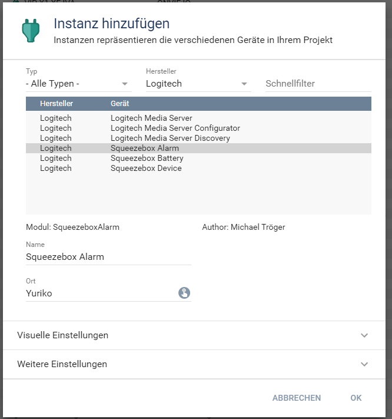
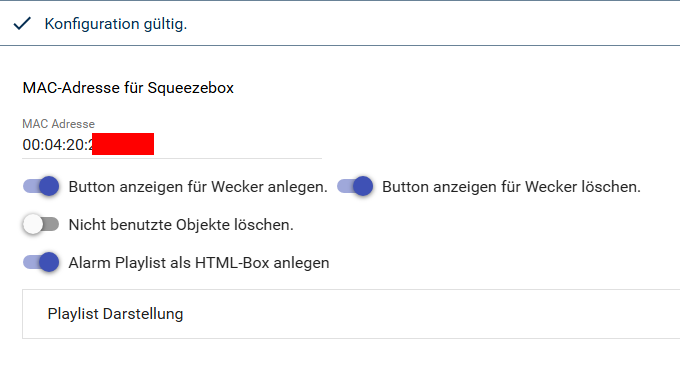
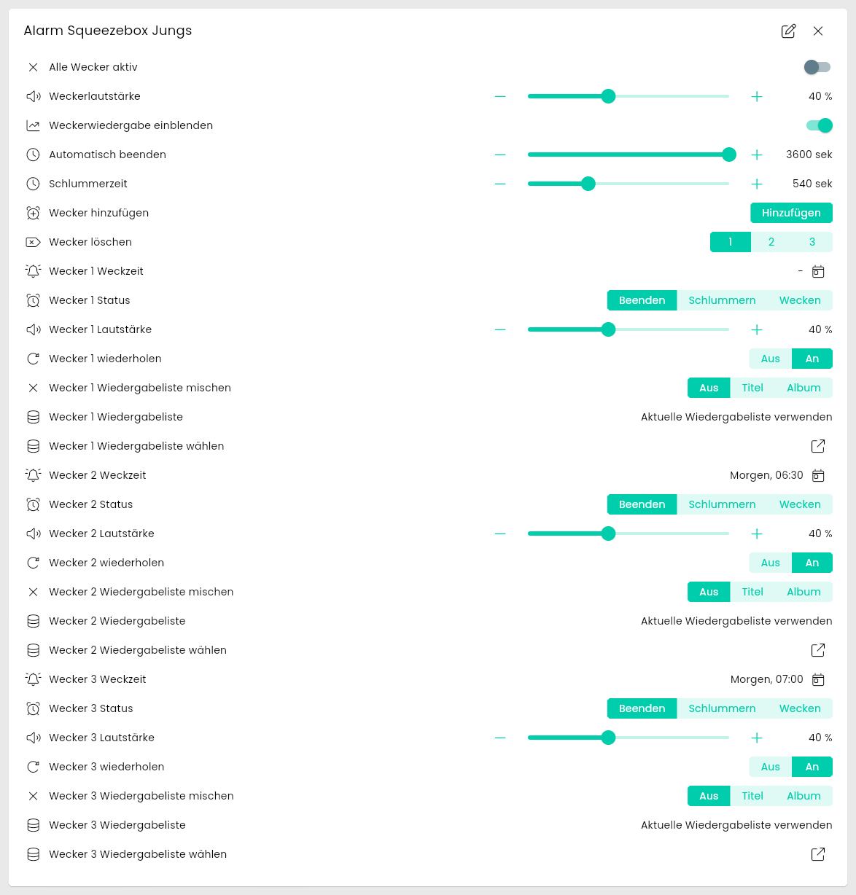
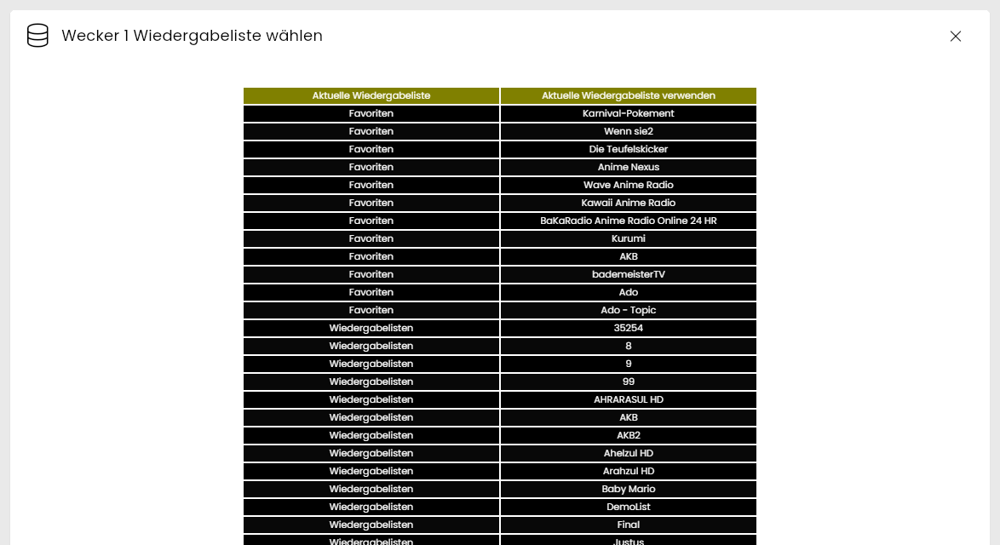
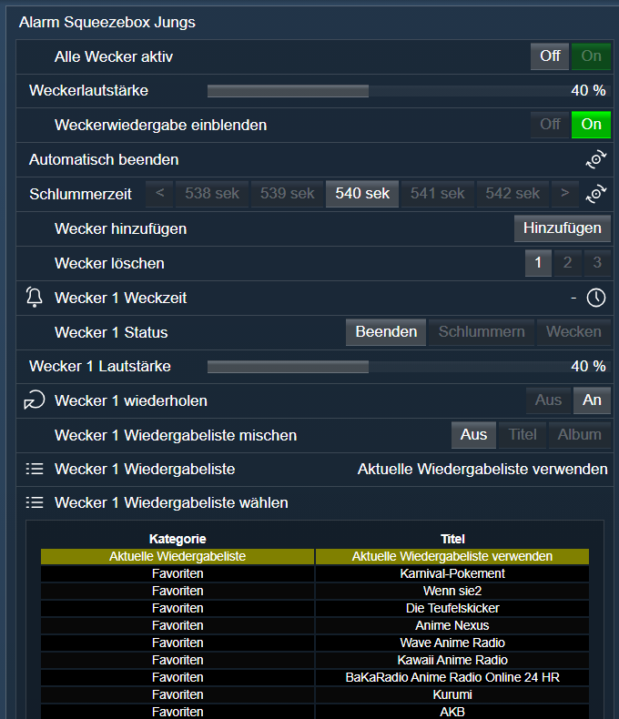
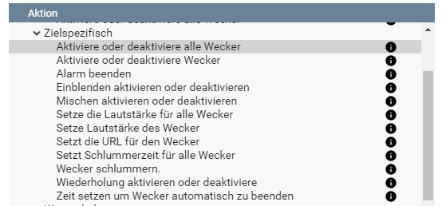

[](https://www.symcon.de/service/dokumentation/entwicklerbereich/sdk-tools/sdk-php/)
[](https://community.symcon.de/t/modul-squeezebox-release/46937)
[](https://www.symcon.de/de/service/dokumentation/installation/migrationen/)  
[](#10-lizenz)
[](https://github.com/Nall-chan/SqueezeBox/actions) [](https://github.com/Nall-chan/SqueezeBox/actions)  
[](#2-spenden)[](#2-spenden)  

# Squeezebox Alarm (Wecker)  <!-- omit in toc -->

Ermöglicht die Steuerung sowie die Darstellung der Zustände  
von den in einer SqueezeBox eingerichteten Weckern in IPS.

## Inhaltsverzeichnis  <!-- omit in toc -->

- [1. Funktionsumfang](#1-funktionsumfang)
- [2. Voraussetzungen](#2-voraussetzungen)
- [3. Software-Installation](#3-software-installation)
- [4. Einrichten der Instanzen in IP-Symcon](#4-einrichten-der-instanzen-in-ip-symcon)
- [5. Statusvariablen](#5-statusvariablen)
- [6. Visualisierung](#6-visualisierung)
  - [Kachel Visualisierung](#kachel-visualisierung)
  - [WebFront Visualisierung](#webfront-visualisierung)
- [7. PHP-Befehlsreferenz](#7-php-befehlsreferenz)
  - [1. Allgemeine Befehle](#1-allgemeine-befehle)
  - [2. Wecker-Befehle](#2-wecker-befehle)
- [8. Aktionen](#8-aktionen)
- [9. Anhang](#9-anhang)
  - [1. Changelog](#1-changelog)
  - [2. Spenden](#2-spenden)
- [10. Lizenz](#10-lizenz)

## 1. Funktionsumfang

- Auslesen und darstellen der Wecker einer Squeezebox.
- Steuern der Wecker über das WebFront und PHP-Befehlen.

## 2. Voraussetzungen

- Symcon ab Version 9.0
- Lyrion Music Server
- kompatibler Player
- Eingerichtete Splitter Instanz vom Typ `Lyrion Music Server` (LMS-Splitter)

## 3. Software-Installation

Dieses Modul ist Bestandteil der [SqueezeBox-Library](../README.md#3-software-installation).  

## 4. Einrichten der Instanzen in IP-Symcon

Eine einfache Einrichtung ist über den Konfigurator [Lyrion Music Server Konfigurator](../LMSConfigurator/README.md) möglich.  
Bei der manuellen Einrichtung ist die Instanz im Dialog `Instanz hinzufügen` unter dem Hersteller `Lyrion` zu finden.  
  

**Konfigurationsseite:**  
  

| Eigenschaft                         | Name                  |   Typ   | Standardwert | Beschreibung                                                                                                         |
| :---------------------------------- | :-------------------- | :-----: | :----------- | :------------------------------------------------------------------------------------------------------------------- |
| MAC Adresse                         | Address               | string  |              | MAC-Adresse der Squeezebox (Format `00:04:20:xx:xx:xx`).                                                             |
| Button anzeigen für Wecker anlegen. | showAdd               | boolean | true         | Legt die Variable `Wecker hinzufügen` an.                                                                            |
| Button anzeigen für Wecker löschen. | showDelete            | boolean | true         | Legt die Variable `Wecker löschen` an.                                                                               |
| Nicht benutzte Objekte löschen.     | dynamicDisplay        | boolean | false        | Löscht Ereignis und Statusvariablen eines Weckers, sobald dieser im LMS gelöscht wird.                               |
| Alarm Playlist als HTML-Box anlegen | showAlarmHTMLPlaylist | boolean | true         | Legt je Wecker die HTML-Box `Wecker X Wiedergabeliste wählen` an.                                                    |
| Darstellung Tabelle                 | Table                 | string  | (Vorgabe)    | CSS der HTML-Tabelle als JSON-Liste (`tag`, `style`), nur mit `showAlarmHTMLPlaylist`. Am besten im Formular ändern. |
| Playlist Spalten                    | Columns               | string  | (Vorgabe)    | Spalten der HTML-Tabelle als JSON-Liste (`key`, `show`, `index`, `name`, `width`, `align`, `color`, `style`).        |
| Playlist Zeilen                     | Rows                  | string  | (Vorgabe)    | Zeilenstile der HTML-Tabelle als JSON-Liste (`row`, `bgcolor`, `color`, `style`).                                    |

**Beispiel:**  

```php
IPS_SetProperty(12345, 'Address', '00:04:20:2e:57:ee');
IPS_SetProperty(12345, 'showDelete', false);
IPS_ApplyChanges(12345);
```

## 5. Statusvariablen

Folgende Statusvariablen werden automatisch angelegt.  

**Statusvariablen allgemein:**  

| Name                        |   Typ   | Ident         | Beschreibung                                                                       |
| :-------------------------- | :-----: | :------------ | :--------------------------------------------------------------------------------- |
| Alle Wecker aktiv           | boolean | EnableAll     | Globaler Ein/Aus-Schalter aller Wecker dieses Gerätes.                             |
| Weckerlautstärke            | integer | DefaultVolume | Standard-Lautstärke `0` bis `100` beim Erstellen eines neuen Weckers.              |
| Weckerwiedergabe einblenden | boolean | FadeIn        | Einblenden der Wiedergabe aktivieren / deaktivieren.                               |
| Automatisch beenden         | integer | Timeout       | Zeit in Sekunden, nach der ein Alarm automatisch beendet wird.                     |
| Schlummerzeit               | integer | SnoozeSeconds | Zeit in Sekunden für den Schlummertimer.                                           |
| Wecker hinzufügen           | integer | AddAlarm      | Optional (`showAdd`). Schaltfläche, legt einen neuen Wecker an.                    |
| Wecker löschen              | integer | DelAlarm      | Optional (`showDelete`). Auswahl des zu löschenden Weckers (Wert = Index, ab `0`). |

**Ereignisse und Statusvariablen pro Wecker:**  

Werden pro in der Squeezebox eingerichteten Wecker automatisch erzeugt.  
Im Ident steht X für den Index des Weckers ab `0`, im Namen für die Nummer ab `1` (Ident `AlarmState0` = `Wecker 1 Status`).  

| Name                             |   Typ    | Ident              | Beschreibung                                                                                                     |
| :------------------------------- | :------: | :----------------- | :--------------------------------------------------------------------------------------------------------------- |
| Wecker X Weckzeit                | Ereignis | AlarmTimeX         | Wöchentliches Ereignis mit Wochentagen und Weckzeit; aktiv, wenn der Wecker aktiv ist.                           |
| Wecker X Status                  | integer  | AlarmStateX        | `0` = Beenden, `1` = Schlummern, `2` = Wecken (läuft). `0` und `1` beenden bzw. pausieren einen laufenden Alarm. |
| Wecker X Wiedergabeliste         |  string  | AlarmPlaylistNameX | Name der gewählten Playlist des Weckers.                                                                         |
| Wecker X wiederholen             | integer  | AlarmRepeatX       | Wöchentliche Wiederholung: `0` = Aus, `1` = An.                                                                  |
| Wecker X Lautstärke              | integer  | AlarmVolumeX       | Lautstärke des Weckers `0` bis `100`.                                                                            |
| Wecker X Wiedergabeliste mischen | integer  | AlarmShuffleX      | Zufallsmodus des Weckers: `0` = Aus, `1` = Titel, `2` = Album.                                                   |
| Wecker X Wiedergabeliste wählen  |  string  | AlarmHTMLPlaylistX | Optional (`showAlarmHTMLPlaylist`). HTML-Box mit allen verfügbaren Alarm-Playlisten.                             |

> [!NOTE]
> Eine Instanz verwaltet höchstens 10 Wecker (X = 0 bis 9). `LSA_AddAlarm` lehnt einen elften Wecker mit einem Hinweis ab. Wecker, die über die LMS-Oberfläche oder am Gerät darüber hinaus angelegt werden, erscheinen nicht in Symcon; wird einer der 10 Wecker gelöscht, rückt der nächste nach.

> [!WARNING]
> Ist `Nicht benutzte Objekte löschen` (`dynamicDisplay`) aktiv, löscht die Instanz Ereignis und Statusvariablen eines Weckers, sobald dieser in der Squeezebox gelöscht wird. Verknüpfungen, Ereignisse oder Skripte, die diese Objekte verwenden, verlieren dann ihr Ziel. Ohne diese Option bleiben die Objekte erhalten und werden nur zurückgesetzt.

## 6. Visualisierung

Die Instanz kann direkt oder über einen Link in der Visualisierung dargestellt werden. Je nach Anzahl der Wecker wird die Darstellung schnell unübersichtlich; dann empfiehlt es sich, mit Links auf einzelne Variablen zu arbeiten.  

### Kachel Visualisierung

  

Die HTML-Box `Wecker X Wiedergabeliste wählen` erscheint in der Liste als Symbol zum Öffnen, als eigene Kachel sieht sie so aus:  
  

### WebFront Visualisierung

  

## 7. PHP-Befehlsreferenz

Für alle Befehle gilt:  
Tritt ein Fehler auf, erzeugt der Befehl einen Hinweis (Notice) mit der Fehlermeldung und liefert `false`. Das aufrufende Skript läuft weiter.  
Dies gilt auch wenn ein übergebener Wert für einen Parameter nicht gültig ist, oder außerhalb seines zulässigen Bereiches liegt.  

### 1. Allgemeine Befehle

```php
bool LSA_RequestState(int $InstanzID, string $Ident);
```

Fordert den Wert einer Statusvariable an.  
Es ist der Ident der Statusvariable zu übergeben, unterstützt werden `EnableAll`, `DefaultVolume`, `FadeIn`, `Timeout`, `SnoozeSeconds` sowie `AlarmPlaylistNameX`, `AlarmRepeatX` und `AlarmVolumeX` (diese lesen alle Wecker neu).  
`AlarmStateX` und `AlarmShuffleX` kann der LMS nicht einzeln liefern.  
Es wird `true` zurückgeben, wenn der LMS geantwortet hat, oder `false` im Fehlerfall.  

---

```php
bool LSA_RequestAllState(int $InstanzID);
```

Liest alle Einstellungen und Wecker des Gerätes neu ein.  
Liefert `true`, wenn alle Abfragen erfolgreich waren, sonst `false` (z.B. wenn der Player nicht verbunden ist).  

---

```php
bool LSA_SetAllActive(int $InstanzID, bool $Value);
```

De/Aktiviert die Wecker-Funktionen des Gerätes.  
`true` zum aktivieren, `false` zum deaktivieren.  
Es wird `true` zurückgeben, wenn der Befehl vom Server bestätigt wurde, oder `false` im Fehlerfall.  

---

```php
bool LSA_SetDefaultVolume(int $InstanzID, int $Value);
```

Setzt die Standard-Lautstärke `0` bis `100` für neue Wecker.  
Es wird `true` zurückgeben, wenn der Befehl vom Server bestätigt wurde, oder `false` im Fehlerfall.  

---

```php
bool LSA_SetFadeIn(int $InstanzID, bool $Value);
```

De/Aktiviert das Einblenden der Wiedergabe.  
`true` zum aktivieren, `false` zum deaktivieren.  
Es wird `true` zurückgeben, wenn der Befehl vom Server bestätigt wurde, oder `false` im Fehlerfall.  

---

```php
bool LSA_SetTimeout(int $InstanzID, int $Value);
```

Setzt die Zeit in Sekunden (ab `0`), nach der ein Wecker automatisch beendet wird.  
Es wird `true` zurückgeben, wenn der Befehl vom Server bestätigt wurde, oder `false` im Fehlerfall.  

---

```php
bool LSA_SetSnoozeSeconds(int $InstanzID, int $Value);
```

Setzt die Schlummerzeit in Sekunden (ab `0`).  
Es wird `true` zurückgeben, wenn der Befehl vom Server bestätigt wurde, oder `false` im Fehlerfall.  

---

```php
bool LSA_AlarmSnooze(int $InstanzID);
```

Sendet das Schlummersignal an das Gerät und pausiert somit einen aktiven Alarm.  
Liefert `true`, wenn der Befehl gesendet wurde, sonst `false`.  

---

```php
bool LSA_AlarmStop(int $InstanzID);
```

Beendet einen aktiven Alarm (Tastendruck `Aus` am Gerät).  
Liefert `true`, wenn der Befehl gesendet wurde, sonst `false`.  

---

```php
int LSA_AddAlarm(int $InstanzID);
```

Erzeugt einen neuen Wecker: aktiv, 07:00 Uhr, wöchentliche Wiederholung, Wiedergabe der aktuellen Playlist. Die Wochentage sind über das Ereignis `Wecker X Weckzeit` einzustellen.  
Es wird der Index des neuen Weckers zurückgegeben, im Fehlerfall `false`.  
Sind bereits 10 Wecker vorhanden, wird ein Hinweis erzeugt und `false` geliefert.  

> [!IMPORTANT]
> Der erste Wecker hat den Index `0`. Das Ergebnis daher mit `=== false` prüfen.

### 2. Wecker-Befehle

**Der Index wird in `$AlarmIndex` übergeben und beginnt mit `0` für den ersten Wecker** (Ident `…0`, Name `Wecker 1 …`).  

```php
bool LSA_DelAlarm(int $InstanzID, int $AlarmIndex);
```

Löscht einen Wecker.  
Es wird `true` zurückgeben, wenn der Befehl vom Server bestätigt wurde, oder `false` im Fehlerfall.  

---

```php
bool LSA_SetPlaylist(int $InstanzID, int $AlarmIndex, string $Url);
```

Setzt die Playlist bzw. die Wiedergabe für den Wecker.  
`$Url` ist das Feld `Url` eines Eintrags aus `LMS_GetAlarmPlaylists` (Splitter). Ein leerer String oder `'0'` wählt die aktuelle Playlist des Players.  
Es wird `true` zurückgeben, wenn der Befehl vom Server bestätigt wurde, oder `false` im Fehlerfall.  

---

```php
bool LSA_SetShuffle(int $InstanzID, int $AlarmIndex, int $Value);
```

Setzt den Modus der zufälligen Wiedergabe des Weckers: `0` = aus, `1` = Titel, `2` = Album.  
Es wird `true` zurückgeben, wenn der Befehl vom Server bestätigt wurde, oder `false` im Fehlerfall.  

---

```php
bool LSA_SetRepeat(int $InstanzID, int $AlarmIndex, bool $Value);
```

De/Aktiviert die wöchentliche Wiederholung. Ohne Wiederholung klingelt der Wecker nur einmal.  
`true` zum aktivieren, `false` zum deaktivieren.  
Es wird `true` zurückgeben, wenn der Befehl vom Server bestätigt wurde, oder `false` im Fehlerfall.  

---

```php
bool LSA_SetVolume(int $InstanzID, int $AlarmIndex, int $Value);
```

Setzt die Lautstärke `0` bis `100` des Weckers.  
Es wird `true` zurückgeben, wenn der Befehl vom Server bestätigt wurde, oder `false` im Fehlerfall.  

**Beispiel:**  

```php
$Index = LSA_AddAlarm(12345);
if ($Index !== false) {
    LSA_SetVolume(12345, $Index, 25);
}
```

## 8. Aktionen

**Grundsätzlich können alle bedienbaren Statusvariablen als Ziel einer [`Aktion`](https://www.symcon.de/service/dokumentation/konzepte/automationen/ablaufplaene/aktionen/) mit `Auf Wert schalten` angesteuert werden, so dass hier keine speziellen Aktionen benutzt werden müssen.**

Dennoch gibt es diverse Aktionen für die `Squeezebox Alarm` Instanz.  
Wenn so eine Instanz als Ziel einer Aktion ausgewählt wurde, stehen folgende Aktionen zur Verfügung:  
  

## 9. Anhang

### 1. Changelog

[Changelog der Library](../README.md#2-changelog)

### 2. Spenden

Die Library ist für die nicht kommerzielle Nutzung kostenlos, Schenkungen als Unterstützung für den Autor werden hier akzeptiert:  

PayPal:  
[](https://paypal.me/Nall4chan)  

Wunschliste:  
[](https://www.amazon.de/hz/wishlist/ls/YU4AI9AQT9F?ref_=wl_share)  

## 10. Lizenz

IPS-Modul:  
[Custom NC-SA](../LICENSE)  
