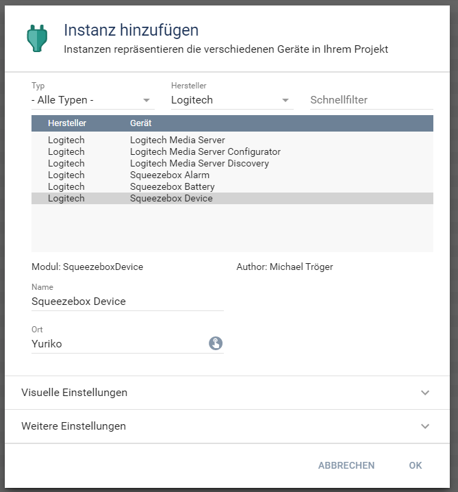
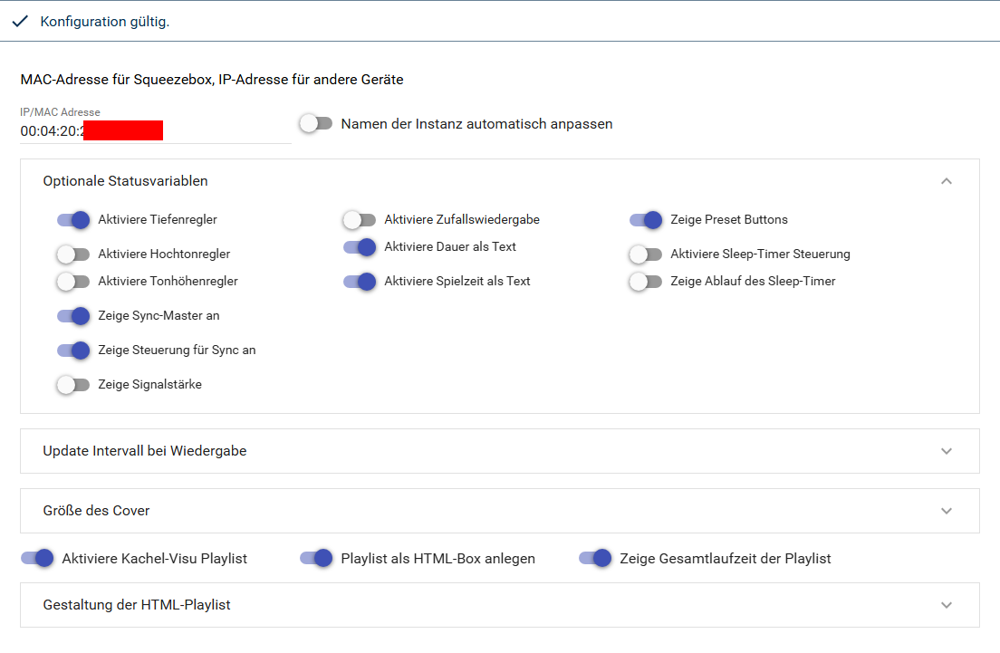
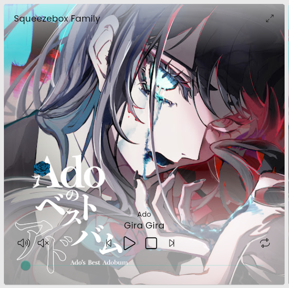
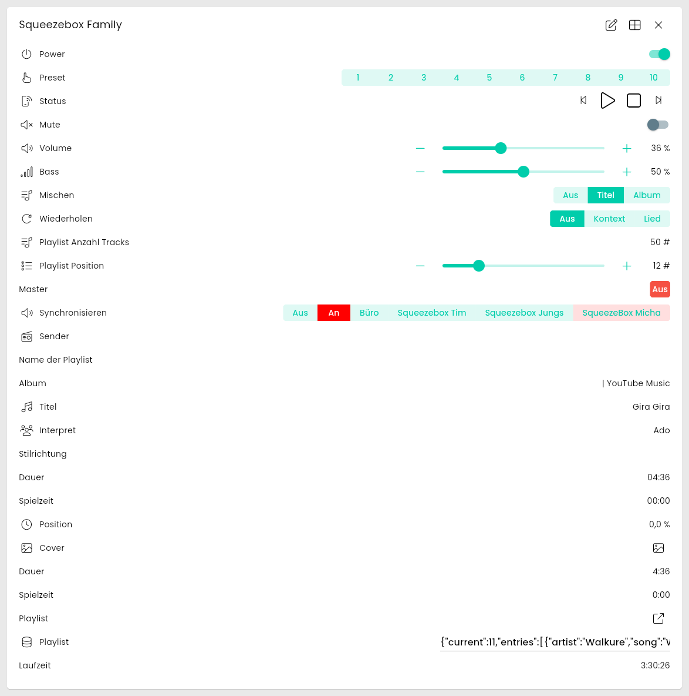
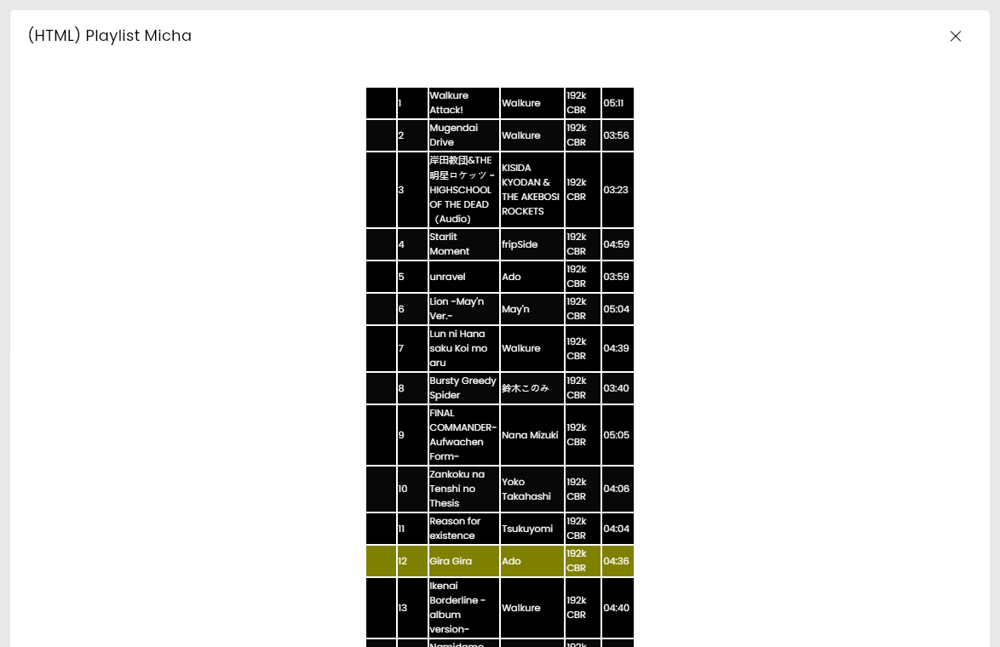
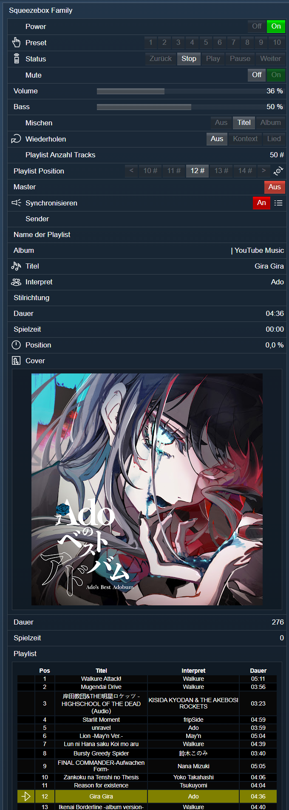
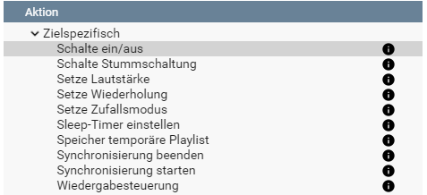

[](https://www.symcon.de/service/dokumentation/entwicklerbereich/sdk-tools/sdk-php/)
[](https://community.symcon.de/t/modul-squeezebox-release/46937)
[](https://www.symcon.de/de/service/dokumentation/installation/migrationen/)  
[](#10-lizenz)
[](https://github.com/Nall-chan/SqueezeBox/actions) [](https://github.com/Nall-chan/SqueezeBox/actions)  
[](#2-spenden)[](#2-spenden)  

# SqueezeBox Player (SqueezeBoxDevice)  <!-- omit in toc -->  

Ermöglicht die Steuerung sowie die Darstellung der Zustände
von SqueezeBox Geräten in IPS, in Verbindung mit dem
Lyrion Music Server.  

## Inhaltsverzeichnis  <!-- omit in toc -->

- [1. Funktionsumfang](#1-funktionsumfang)
- [2. Voraussetzungen](#2-voraussetzungen)
- [3. Software-Installation](#3-software-installation)
- [4. Einrichten der Instanzen in IP-Symcon](#4-einrichten-der-instanzen-in-ip-symcon)
- [5. Statusvariablen](#5-statusvariablen)
- [6. Visualisierung](#6-visualisierung)
  - [Kachel Visualisierung](#kachel-visualisierung)
  - [WebFront Visualisierung](#webfront-visualisierung)
- [7. PHP-Befehlsreferenz](#7-php-befehlsreferenz)
  - [1. Allgemein](#1-allgemein)
  - [2. Steuerung](#2-steuerung)
  - [3. Playlist](#3-playlist)
  - [4. Zufallswiedergabe](#4-zufallswiedergabe)
  - [5. Synchronisieren](#5-synchronisieren)
- [8. Aktionen](#8-aktionen)
- [9. Anhang](#9-anhang)
  - [1. Changelog](#1-changelog)
  - [2. Spenden](#2-spenden)
- [10. Lizenz](#10-lizenz)

## 1. Funktionsumfang

- Steuern und Abfragen der diversen verschiedenen Zustände und Eigenschaften.  
- Abfragen, Laden, bearbeiten und speichern der Playlist des Gerätes.  
- Synchronisierung steuern.  
- Fähigkeiten über das WebFront und die Kachel-Visualisierung:  
  - Modus: Play, Pause, Stop, Gruppierung
  - Audio: Lautstärke mit Stummschaltung, und wenn vom Gerät unterstützt, auch Tonhöhe sowie Höhen und Bass.
  - Bedienung der Preset-Tasten vom Gerät.
  - Sleeptimer: Setzen und löschen des Timer.
  - Playlist: Trackwahl, nächster, vorheriger Track, Wiederholung und Zufallsmodus
  - Darstellung der Daten zum aktuellen Track: Titel, Album, Interpret, Stilrichtung, Cover etc..
  - Darstellen der aktuellen Playlist als Tabelle sowie auswahl eines Tracks.  

## 2. Voraussetzungen

- Symcon ab Version 9.0
- Lyrion Music Server
- kompatibler Player

## 3. Software-Installation  

Dieses Modul ist Bestandteil der [SqueezeBox-Library](../README.md#3-software-installation).  

## 4. Einrichten der Instanzen in IP-Symcon

Eine einfache Einrichtung ist über den Konfigurator [Lyrion Music Server Konfigurator](../LMSConfigurator/README.md) möglich.  
Bei der manuellen Einrichtung ist die Instanz im Dialog `Instanz hinzufügen` unter dem Hersteller `Lyrion` zu finden.  
  

**Konfigurationsseite:**  

  

| Eigenschaft                            | Name               |   Typ   | Standardwert | Beschreibung                                                                                                          |
| :------------------------------------- | :----------------- | :-----: | :----------- | :-------------------------------------------------------------------------------------------------------------------- |
| IP/MAC Adresse                         | Address            | string  |              | MAC-Adresse der Squeezebox (Format `00:04:20:xx:xx:xx`), IP-Adresse bei anderen Playern.                              |
| Namen der Instanz automatisch anpassen | changeName         | boolean | false        | Instanz umbenennen, wenn sich der Name des Players im LMS ändert.                                                     |
| Aktiviere Tiefenregler                 | enableBass         | boolean | false        | Statusvariable `Bass` anlegen.                                                                                        |
| Aktiviere Hochtonregler                | enableTreble       | boolean | false        | Statusvariable `Hochtonregler` anlegen.                                                                               |
| Aktiviere Tonhöhenregler               | enablePitch        | boolean | false        | Statusvariable `Tonhöhenregler` anlegen.                                                                              |
| Aktiviere Zufallswiedergabe            | enableRandomplay   | boolean | false        | Statusvariable `Zufallswiedergabe` anlegen.                                                                           |
| Aktiviere Dauer als Text               | enableDurationText | boolean | false        | Statusvariable `Dauer als Text` anlegen (abgekündigt).                                                                |
| Aktiviere Spielzeit als Text           | enablePositionText | boolean | false        | Statusvariable `Spielzeit als Text` anlegen (abgekündigt).                                                            |
| Zeige Preset Buttons                   | enablePreset       | boolean | false        | Statusvariable `Preset` anlegen.                                                                                      |
| Aktiviere Sleep-Timer Steuerung        | enableSleepTimer   | boolean | false        | Statusvariable `Einschlaftimer` anlegen.                                                                              |
| Zeige Ablauf des Sleep-Timer           | showSleepTimeout   | boolean | false        | Statusvariable `Ausschalten in` anlegen.                                                                              |
| Zeige Sync-Master an                   | showSyncMaster     | boolean | false        | Statusvariable `Master` anlegen.                                                                                      |
| Zeige Steuerung für Sync an            | showSyncControl    | boolean | false        | Statusvariable `Synchronisieren` anlegen.                                                                             |
| Zeige Signalstärke                     | showSignalstrength | boolean | false        | Statusvariable `Signalstärke` anlegen.                                                                                |
| Intervall                              | Interval           | integer | 2            | Abstand in Sekunden, in dem der LMS während der Wiedergabe den Status sendet (ab `0`).                                |
| Größe Cover                            | CoverSize          | string  | cover        | `cover` = Originalgröße, sonst `coverBxH` mit 96, 100 und 125 bis 500 in Schritten von 25 Pixel, z.B. `cover300x300`. |
| Aktiviere Kachel-Visu Playlist         | showTilePlaylist   | boolean | true         | Statusvariable `Playlist` (Ident `TilePlaylist`) für die Media-Kachel anlegen.                                        |
| Playlist als HTML-Box anlegen          | showHTMLPlaylist   | boolean | false        | Statusvariable `Playlist` (Ident `HTMLPlaylist`) als HTML-Box anlegen.                                                |
| Zeige Gesamtlaufzeit der Playlist      | showTotalPlaytime  | boolean | true         | Statusvariable `Laufzeit` anlegen.                                                                                    |
| Darstellung Tabelle                    | Table              | string  | (Vorgabe)    | CSS der HTML-Playlist als JSON-Liste (`tag`, `style`), nur mit `showHTMLPlaylist`. Am besten im Formular ändern.      |
| Playlist Spalten                       | Columns            | string  | (Vorgabe)    | Spalten der HTML-Playlist als JSON-Liste (`key`, `show`, `index`, `name`, `width`, `align`, `color`, `style`).        |
| Playlist Zeilen                        | Rows               | string  | (Vorgabe)    | Zeilenstile der HTML-Playlist als JSON-Liste (`row`, `bgcolor`, `color`, `style`).                                    |

> [!NOTE]
> Player, die mit einer IP-Adresse eingerichtet sind (z.B. Software-Player), lassen sich nicht ein- und ausschalten. Für sie entfallen die Variablen `Power`, `Preset`, `Mute`, `Volume`, `Bass`, `Hochtonregler`, `Tonhöhenregler`, `Master`, `Synchronisieren` und `Signalstärke`.

**Beispiel:**  

```php
IPS_SetProperty(12345, 'Address', '00:04:20:2e:57:ee');
IPS_SetProperty(12345, 'CoverSize', 'cover300x300');
IPS_SetProperty(12345, 'showSyncControl', true);
IPS_ApplyChanges(12345);
```

## 5. Statusvariablen

Folgende Statusvariablen werden automatisch angelegt.  
Variablen, die nur mit einer Option aus [4. Einrichten](#4-einrichten-der-instanzen-in-ip-symcon) angelegt werden, sind als „optional“ gekennzeichnet.  

| Name                     |     Typ      | Ident          | Beschreibung                                                                                                                             |
| :----------------------- | :----------: | :------------- | :--------------------------------------------------------------------------------------------------------------------------------------- |
| Power                    |   boolean    | Power          | Player ein- oder ausgeschaltet.                                                                                                          |
| Status                   |   integer    | Status         | Wiedergabe: `0` = Zurück, `1` = Stop, `2` = Play, `3` = Pause, `4` = Weiter (`0` und `4` sind nur Bedienelemente).                       |
| Preset                   |   integer    | Preset         | Optional. Ruft die Preset-Taste `1` bis `10` des Players auf.                                                                            |
| Mute                     |   boolean    | Mute           | Stummschaltung.                                                                                                                          |
| Volume                   |   integer    | Volume         | Lautstärke `0` bis `100`.                                                                                                                |
| Bass                     |   integer    | Bass           | Optional. Tiefen `0` bis `100`.                                                                                                          |
| Hochtonregler            |   integer    | Treble         | Optional. Höhen `0` bis `100`.                                                                                                           |
| Tonhöhenregler           |   integer    | Pitch          | Optional. Tonhöhe `80` bis `120`.                                                                                                        |
| Zufallswiedergabe        |   integer    | Randomplay     | Optional. `0` = Aus, `1` = Titel, `2` = Album, `3` = Interpret, `4` = Jahr.                                                              |
| Master                   |   boolean    | Master         | Optional. `true`, wenn der Player der Master einer Sync-Gruppe ist.                                                                      |
| Synchronisieren          |   integer    | Sync           | Optional. `0` = Aus (Synchronisierung beenden), `100` = An (nur Anzeige), Instanz-ID eines anderen Players = mit diesem synchronisieren. |
| Mischen                  |   integer    | Shuffle        | `0` = Aus, `1` = Titel, `2` = Album.                                                                                                     |
| Wiederholen              |   integer    | Repeat         | `0` = Aus, `1` = Playlist (Anzeige „Kontext“), `2` = Titel (Anzeige „Lied“).                                                             |
| Playlist Aktueller Track |   integer    | Index          | Position des aktuellen Titels in der Playlist ab `1`.                                                                                    |
| Playlist Anzahl Tracks   |   integer    | Tracks         | Anzahl der Titel in der Playlist.                                                                                                        |
| Sender                   |    string    | StationName    | Name des Senders bei Streams (z.B. Internetradio), sonst leer.                                                                           |
| Name der Playlist        |    string    | Playlistname   | Name der geladenen Playlist bzw. des Favoriten oder Streams, sofern vorhanden.                                                           |
| Album                    |    string    | Album          | Album des aktuellen Titels.                                                                                                              |
| Titel                    |    string    | Title          | Titel des aktuellen Titels.                                                                                                              |
| Interpret                |    string    | Artist         | Interpret des aktuellen Titels.                                                                                                          |
| Stilrichtung             |    string    | Genre          | Stilrichtung des aktuellen Titels.                                                                                                       |
| Dauer                    |   integer    | Duration       | Dauer des aktuellen Titels in Sekunden.                                                                                                  |
| Dauer als Text           |    string    | DurationText   | Optional, abgekündigt. Dauer als Text.                                                                                                   |
| Spielzeit                |   integer    | Position       | Aktuelle Position im Titel in Sekunden.                                                                                                  |
| Spielzeit als Text       |    string    | PositionText   | Optional, abgekündigt. Aktuelle Position als Text.                                                                                       |
| Position                 |    float     | Position2      | Aktuelle Position im Titel in Prozent. Bei Streams `0` und nicht bedienbar.                                                              |
| Signalstärke             |   integer    | Signalstrength | Optional. WLAN-Signalstärke des Players.                                                                                                 |
| Einschlaftimer           |   integer    | SleepTimer     | Optional. Einschlaftimer in Sekunden (`0` bis `5400` in Minutenschritten, `0` = aus).                                                    |
| Ausschalten in           |   integer    | SleepTimeout   | Optional. Restzeit bis zum Ausschalten in Sekunden.                                                                                      |
| Laufzeit                 |   integer    | TotalRuntime   | Optional. Gesamtlaufzeit der Playlist in Sekunden.                                                                                       |
| Playlist                 |    string    | TilePlaylist   | Optional. Playlist für die Media-Kachel der Kachel-Visualisierung (Darstellung `~Playlist`); Auswahl eines Eintrags springt dorthin.     |
| Playlist                 |    string    | HTMLPlaylist   | Optional. HTML-Box mit der Playlist; ein Klick auf einen Titel springt dorthin.                                                          |
| Cover                    | Medienobjekt | CoverIMG       | Cover des aktuellen Titels.                                                                                                              |

> [!IMPORTANT]
> Die Werte von `Status` und `Wiederholen` entsprechen den Symcon-Darstellungen `~PlaybackPreviousNext` und `~Repeat`, nicht den Werten des LMS. Bei `Wiederholen` sind `1` und `2` gegenüber dem LMS (und `LSQ_SetRepeat`) vertauscht.

> [!NOTE]
> Wurde eine Instanz vor Version 4.10 angelegt, kann es noch die Variable `SleepTimeout (old)` (Ident `SleepTimeoutOld`, String) geben. Sie wird nicht mehr beschrieben und kann gelöscht werden.

## 6. Visualisierung

Die Instanz kann direkt oder über einen Link in der Visualisierung dargestellt werden.  
Die Variable `Playlist` (Ident `TilePlaylist`) ist nur für die Media-Kachel gedacht. In der Liste und im WebFront erscheint ihr Inhalt als Text (JSON). Wird die Media-Kachel nicht genutzt, kann sie über die Option `Aktiviere Kachel-Visu Playlist` abgeschaltet werden.  

### Kachel Visualisierung

Darstellung der Instanz als Media-Kachel:  
  

Darstellung als Liste:  
  

Die HTML-Playlist erscheint in der Liste als Symbol zum Öffnen, als eigene Kachel sieht sie so aus:  
  

### WebFront Visualisierung

  

## 7. PHP-Befehlsreferenz

Für alle Befehle gilt:  
Tritt ein Fehler auf, erzeugt der Befehl einen Hinweis (Notice) mit der Fehlermeldung und liefert `false`. Das aufrufende Skript läuft weiter.  
Dies gilt auch wenn ein übergebener Wert für einen Parameter nicht gültig ist, oder außerhalb seines zulässigen Bereiches liegt.  
Ist der Player nicht mit dem LMS verbunden, erzeugen die Befehle einen Hinweis und liefern `false`.  

Positionen in der Playlist (`$Position`, `$Index`) beginnen mit `1` für den ersten Titel, sofern nicht anders angegeben.  

### 1. Allgemein

```php
string LSQ_GetName(int $InstanzID);
```

Liefert den Namen des Players im LMS.  
Ist `Namen der Instanz automatisch anpassen` aktiv, wird dabei auch die Instanz umbenannt.  
Im Fehlerfall wird `false` zurückgegeben.  

---

```php
bool LSQ_SetName(int $InstanzID, string $Name);
```

Setzt den Namen des Players im LMS auf `$Name`.  
Liefert `true` bei Erfolg, sonst `false`.  

---

```php
bool LSQ_RequestState(int $InstanzID, string $Ident);
```

Fordert den Wert einer Statusvariable beim LMS an.  
Es ist der Ident der Statusvariable zu übergeben, z.B. `Volume`, `Status` oder `Title` (siehe [5. Statusvariablen](#5-statusvariablen)). Für optionale Variablen muss die zugehörige Option aktiv sein.  
Es wird `true` zurückgeben, wenn der LMS geantwortet hat, oder `false` im Fehlerfall.  

---

```php
bool LSQ_RequestAllState(int $InstanzID);
```

Fragt alle Statusvariablen, Cover und Playlist neu beim LMS ab.  
Liefert `true` bei Erfolg, sonst `false` (z.B. wenn der Player nicht verbunden ist).  

### 2. Steuerung

```php
bool LSQ_Power(int $InstanzID, bool $Value);
```

Schaltet den Player ein (`true`) oder aus (`false`).  
Liefert `true` bei Erfolg, sonst `false`.  

---

```php
bool LSQ_Play(int $InstanzID);
bool LSQ_PlayEx(int $InstanzID, int $FadeIn);
```

Startet die Wiedergabe.  
Mit `LSQ_PlayEx` kann eine Einblendzeit `$FadeIn` in Sekunden übergeben werden.  
Liefert `true` bei Erfolg, sonst `false`.  

---

```php
bool LSQ_Pause(int $InstanzID);
```

Pausiert die Wiedergabe.  
Liefert `true` bei Erfolg, sonst `false`.  

---

```php
bool LSQ_Stop(int $InstanzID);
```

Stoppt die Wiedergabe.  
Liefert `true` bei Erfolg, sonst `false`.  

---

```php
bool LSQ_SetVolume(int $InstanzID, int $Value);
bool LSQ_SetVolumeEx(int $InstanzID, string $Value);
```

Setzt die Lautstärke.  
`LSQ_SetVolume` erwartet einen absoluten Wert von `0` bis `100`.  
`LSQ_SetVolumeEx` ändert die Lautstärke relativ und erwartet einen String mit Vorzeichen von `-100` bis `+100`, z.B. `'+5'` oder `'-10'`.  
Liefert `true` bei Erfolg, sonst `false`.  

**Beispiel:**  

```php
LSQ_SetVolume(12345, 30);
LSQ_SetVolumeEx(12345, '+5');   // Lautstärke um 5 erhöhen
```

---

```php
bool LSQ_SetMute(int $InstanzID, bool $Value);
```

Schaltet die Stummschaltung ein (`true`) oder aus (`false`).  
Liefert `true` bei Erfolg, sonst `false`.  

---

```php
bool LSQ_SetPosition(int $InstanzID, int $Value);
```

Springt im aktuellen Titel auf die Zeit `$Value` in Sekunden.  
Ein Wert größer als die Dauer des Titels wird abgelehnt.  
Liefert `true` bei Erfolg, sonst `false`.  

---

```php
bool LSQ_SetBass(int $InstanzID, int $Value);
bool LSQ_SetBassEx(int $InstanzID, string $Value);
bool LSQ_SetTreble(int $InstanzID, int $Value);
bool LSQ_SetTrebleEx(int $InstanzID, string $Value);
bool LSQ_SetPitch(int $InstanzID, int $Value);
bool LSQ_SetPitchEx(int $InstanzID, string $Value);
```

Setzt Tiefen (Bass), Höhen (Treble) bzw. Tonhöhe (Pitch).  
Die Funktionen setzen voraus, dass der jeweilige Regler in der Instanz aktiviert ist (`enableBass`, `enableTreble`, `enablePitch`).  
Laut LMS unterstützen nur SliMP3 und Squeezebox 1 (SB1) Tiefen und Höhen, die Tonhöhe nur die Squeezebox 1.  

| Funktion          | Wertebereich `$Value`          |
| :---------------- | :----------------------------- |
| `LSQ_SetBass`     | `0` bis `100`                  |
| `LSQ_SetTreble`   | `0` bis `100`                  |
| `LSQ_SetPitch`    | `80` bis `120`                 |
| `LSQ_SetBassEx`   | relativ, `'-100'` bis `'+100'` |
| `LSQ_SetTrebleEx` | relativ, `'-100'` bis `'+100'` |
| `LSQ_SetPitchEx`  | relativ, `'-40'` bis `'+40'`   |

Liefert `true` bei Erfolg, sonst `false`.  

---

```php
bool LSQ_SetSleep(int $InstanzID, int $Seconds);
```

Aktiviert den Einschlaftimer: Der Player schaltet sich nach `$Seconds` Sekunden aus.  
`0` deaktiviert den zuvor gesetzten Einschlaftimer.  
Liefert `true` bei Erfolg, sonst `false`.  

---

```php
bool LSQ_PreviousButton(int $InstanzID);
bool LSQ_NextButton(int $InstanzID);
```

Simuliert einen Tastendruck auf die Taste Zurück bzw. Vorwärts des Players.  
Liefert `true` bei Erfolg, sonst `false`.  

---

```php
bool LSQ_PressButton(int $InstanzID, string $ButtonCode);
```

Simuliert einen Tastendruck. `$ButtonCode` ist ein Tastencode des LMS (z.B. `play`, `pause`, `jump_fwd`, `volup`, `voldown`; siehe `Default.map` des LMS).  
Liefert `true`, wenn der LMS den Tastencode bestätigt hat, sonst `false`.  

---

```php
bool LSQ_SelectPreset(int $InstanzID, int $Value);
```

Simuliert einen Tastendruck auf die Preset-Taste `$Value` (`1` bis `10`).  
Liefert `true` bei Erfolg, sonst `false`.  

---

```php
bool LSQ_DisplayLine(int $InstanzID, string $Text, int $Duration);
bool LSQ_DisplayLineEx(int $InstanzID, string $Text, int $Duration, bool $Centered, int $Brightness);
bool LSQ_Display2Lines(int $InstanzID, string $Text1, string $Text2, int $Duration);
bool LSQ_Display2LinesEx(int $InstanzID, string $Text1, string $Text2, int $Duration, bool $Centered, int $Brightness);
```

Zeigt einen Text für `$Duration` Sekunden (mindestens `3`) auf dem Display des Players an.  
`LSQ_DisplayLine` zeigt eine Zeile in großer Schrift, `LSQ_Display2Lines` zwei Zeilen in normaler Schrift.  
`$Centered` zentriert den Text (zentrierter Text läuft nicht durch), `$Brightness` setzt die Helligkeit von `0` bis `4`.  
Liefert `true`, wenn der Befehl gesendet wurde, sonst `false`.  

**Beispiel:**  

```php
LSQ_Display2Lines(12345, 'Haustür', 'Es hat geklingelt', 10);
```

---

```php
bool LSQ_DisplayText(int $InstanzID, string $Text1, string $Text2, int $Duration);
```

Zeigt zwei Zeilen für `$Duration` Sekunden (mindestens `3`) auf dem Display an (LMS-Befehl `display`).  
Liefert `true` bei Erfolg, sonst `false`.  

---

```php
int LSQ_GetLinesPerScreen(int $InstanzID);
```

Liefert die Anzahl der Textzeilen, die das Display mit der aktuellen Schrift darstellen kann.  
Im Fehlerfall wird `false` zurückgegeben.  

---

```php
array LSQ_GetDisplayedText(int $InstanzID);
array LSQ_GetDisplayedNow(int $InstanzID);
```

Liefert den Text auf dem Display als Array mit zwei Zeilen.  
`LSQ_GetDisplayedText` liefert den aktuellen Anzeigetext, `LSQ_GetDisplayedNow` die zuletzt an das Display gesendeten Daten (auch Animationen).  
Im Fehlerfall wird `false` zurückgegeben.  

### 3. Playlist

```php
bool LSQ_PlayUrl(int $InstanzID, string $URL);
bool LSQ_PlayUrlEx(int $InstanzID, string $URL, string $DisplayTitle);
```

Ersetzt die Playlist durch `$URL` und startet die Wiedergabe.  
`$URL` ist eine Datei, ein Verzeichnis oder ein Stream, z.B. `file:///…` (wie in den Songinfos im Feld `Url`, Kodierung wie `%20` beibehalten) oder `http://…`.  
`$DisplayTitle` ist der Anzeigetitel, unter dem der Eintrag in der Playlist erscheint (bei Streams statt der URL).  
Liefert `true` bei Erfolg, sonst `false`.  

**Beispiel:**  

```php
LSQ_PlayUrlEx(12345, 'http://stream.radioparadise.com/mp3-128', 'Radio Paradise');
```

---

```php
bool LSQ_PlayUrlSpecial(int $InstanzID, string $URL);
bool LSQ_PlayUrlSpecialEx(int $InstanzID, string $URL, string $DisplayTitle);
```

Wie `LSQ_PlayUrl(Ex)`, aber ohne Prüfung der URL. Für besondere URLs von Plugins, z.B. `spotify:playlist:…`.  
Liefert `true` bei Erfolg, sonst `false`.  

---

```php
bool LSQ_PlayFavorite(int $InstanzID, string $FavoriteID);
```

Spielt den Favoriten `$FavoriteID` ab. Die IDs liefert `LMS_GetFavorites` als Array-Schlüssel (z.B. `'1'` oder `'6.1'`).  
Liefert `true`, wenn der Befehl gesendet wurde, sonst `false`.  

---

```php
bool LSQ_SetShuffle(int $InstanzID, int $Value);
```

Setzt den Modus für die zufällige Wiedergabe der Playlist: `0` = aus, `1` = nach Titeln, `2` = nach Alben.  
Liefert `true` bei Erfolg, sonst `false`.  

---

```php
bool LSQ_SetRepeat(int $InstanzID, int $Value);
```

Setzt den Modus für Wiederholungen: `0` = aus, `1` = aktuellen Titel wiederholen, `2` = ganze Playlist wiederholen.  
Die Werte entsprechen dem LMS; in der Statusvariable `Wiederholen` sind `1` und `2` vertauscht.  
Liefert `true` bei Erfolg, sonst `false`.  

---

```php
bool LSQ_GoToTrack(int $InstanzID, int $Index);
```

Springt in der Playlist auf den Titel an Position `$Index` (`1` bis Anzahl der Titel).  
Liefert `true` bei Erfolg, sonst `false`.  

---

```php
bool LSQ_NextTrack(int $InstanzID);
bool LSQ_PreviousTrack(int $InstanzID);
```

Springt in der Playlist auf den nächsten bzw. vorherigen Titel.  
Liefert `true` bei Erfolg, sonst `false`.  

---

```php
string LSQ_LoadPlaylist(int $InstanzID, string $Name);
```

Ersetzt die Playlist durch die gespeicherte Playlist `$Name` (Name ohne `.m3u`, wie in `LMS_GetPlaylists` im Feld `Playlist`). Statt eines Namens ist auch eine URL zu einer Datei, einem Verzeichnis oder Stream möglich.  
Die Wiedergabe wird nicht automatisch gestartet.  
Liefert den Pfad der Playlist, ist sie unbekannt, wird ein Hinweis erzeugt und `false` geliefert.  

---

```php
string LSQ_ResumePlaylist(int $InstanzID, string $Name);
```

Wie `LSQ_LoadPlaylist`, springt aber auf den Titel, der beim Speichern der Playlist gespielt wurde.  
Die Wiedergabe wird nicht automatisch gestartet.  
Liefert den Pfad der Playlist, ist sie unbekannt, wird ein Hinweis erzeugt und `false` geliefert.  

---

```php
bool LSQ_SavePlaylist(int $InstanzID, string $Name);
```

Speichert die aktuelle Playlist des Players auf dem LMS als Playlist `$Name` (ohne `.m3u`). Eine vorhandene Playlist mit diesem Namen wird überschrieben.  
Liefert `true` bei Erfolg, sonst `false`.  

---

```php
bool LSQ_SaveTempPlaylist(int $InstanzID);
bool LSQ_LoadTempPlaylist(int $InstanzID);
```

Sichert die aktuelle Playlist bzw. stellt sie wieder her, z.B. um nach einer Durchsage die vorherige Wiedergabe fortzusetzen.  
`LSQ_SaveTempPlaylist` speichert die Playlist auf dem LMS unter dem festen Namen `tempplaylist_<MAC ohne Doppelpunkte>`, z.B. `tempplaylist_0004202e57ee`. Eine vorhandene Sicherung wird überschrieben.  
`LSQ_LoadTempPlaylist` lädt diese Sicherung, springt auf den zuletzt gespielten Titel, startet die Wiedergabe und **löscht die Sicherung** auf dem LMS.  
Liefert `true` bei Erfolg, sonst `false`.  

> [!IMPORTANT]
> Nach `LSQ_SaveTempPlaylist` trägt die aktuelle Playlist beim LMS den Namen der Sicherung (`tempplaylist_…`), z.B. in `Name der Playlist`.  
> `LSQ_LoadTempPlaylist` ist nur einmal je Sicherung möglich: Ein zweiter Aufruf findet keine Sicherung mehr und leert die Playlist.

**Beispiel:**  

```php
LSQ_SaveTempPlaylist(12345);
LSQ_PlayUrlEx(12345, 'file:///E:/Durchsagen/Klingel.mp3', 'Klingel');
// ... warten bis die Durchsage beendet ist ...
LSQ_LoadTempPlaylist(12345);
```

---

```php
bool LSQ_PreviewPlaylistStart(int $InstanzID, string $Name);
bool LSQ_PreviewPlaylistStop(int $InstanzID);
```

`LSQ_PreviewPlaylistStart` ersetzt die Playlist vorübergehend durch `$Name` (Playlist-Name oder URL) und sichert die bisherige Playlist auf dem LMS.  
`LSQ_PreviewPlaylistStop` stellt die vorherige Playlist wieder her.  
Liefert `true` bei Erfolg, sonst `false`.  

> [!NOTE]
> Die Vorschau-Funktionen wurden nicht live geprüft; Beschreibung laut LMS-Dokumentation.

---

```php
bool LSQ_LoadPlaylistByFavoriteID(int $InstanzID, string $FavoriteID);
bool LSQ_LoadPlaylistByAlbumID(int $InstanzID, int $AlbumID);
bool LSQ_LoadPlaylistByGenreID(int $InstanzID, int $GenreID);
bool LSQ_LoadPlaylistByArtistID(int $InstanzID, int $ArtistID);
bool LSQ_LoadPlaylistByPlaylistID(int $InstanzID, int $PlaylistID);
bool LSQ_LoadPlaylistByFolderID(int $InstanzID, int $FolderID);
bool LSQ_LoadPlaylistBySongIDs(int $InstanzID, string $SongIDs);
```

Ersetzt die Playlist durch die Titel des Favoriten, Albums, Genres, Interpreten, der gespeicherten Playlist, des Ordners bzw. der Titel mit den Track-Ids aus `$SongIDs`.  
Die IDs stammen aus den Funktionen des Splitters (z.B. `LMS_GetAlbums`, `LMS_GetGenres`, `LMS_GetArtists`, `LMS_GetPlaylists`, `LMS_GetDirectoryByID`; bei Favoriten der Array-Schlüssel aus `LMS_GetFavorites`, z.B. `'1'` oder `'6.1'`).  
`$SongIDs` enthält eine oder mehrere Track-Ids, kommagetrennt, z.B. `'220161,241158'`.  
Liefert `true` bei Erfolg, sonst `false` (z.B. wenn zur ID keine Titel gefunden wurden).  

---

```php
bool LSQ_AddToPlaylistByFavoriteID(int $InstanzID, string $FavoriteID);
bool LSQ_AddToPlaylistByAlbumID(int $InstanzID, int $AlbumID);
bool LSQ_AddToPlaylistByGenreID(int $InstanzID, int $GenreID);
bool LSQ_AddToPlaylistByArtistID(int $InstanzID, int $ArtistID);
bool LSQ_AddToPlaylistByPlaylistID(int $InstanzID, int $PlaylistID);
bool LSQ_AddToPlaylistByFolderID(int $InstanzID, int $FolderID);
bool LSQ_AddToPlaylistBySongIDs(int $InstanzID, string $SongIDs);
```

Hängt die Titel wie bei `LSQ_LoadPlaylistBy…` an das Ende der Playlist an.  
Liefert `true` bei Erfolg, sonst `false`.  

---

```php
bool LSQ_InsertInPlaylistByFavoriteID(int $InstanzID, string $FavoriteID);
bool LSQ_InsertInPlaylistByAlbumID(int $InstanzID, int $AlbumID);
bool LSQ_InsertInPlaylistByGenreID(int $InstanzID, int $GenreID);
bool LSQ_InsertInPlaylistByArtistID(int $InstanzID, int $ArtistID);
bool LSQ_InsertInPlaylistByPlaylistID(int $InstanzID, int $PlaylistID);
bool LSQ_InsertInPlaylistByFolderID(int $InstanzID, int $FolderID);
bool LSQ_InsertInPlaylistBySongIDs(int $InstanzID, string $SongIDs);
```

Fügt die Titel wie bei `LSQ_LoadPlaylistBy…` hinter dem aktuellen Titel ein (werden als nächstes gespielt).  
Liefert `true` bei Erfolg, sonst `false`.  

---

```php
bool LSQ_DeleteFromPlaylistByAlbumID(int $InstanzID, int $AlbumID);
bool LSQ_DeleteFromPlaylistByGenreID(int $InstanzID, int $GenreID);
bool LSQ_DeleteFromPlaylistByArtistID(int $InstanzID, int $ArtistID);
bool LSQ_DeleteFromPlaylistByPlaylistID(int $InstanzID, int $PlaylistID);
bool LSQ_DeleteFromPlaylistBySongIDs(int $InstanzID, string $SongIDs);
```

Entfernt alle Titel des Albums, Genres, Interpreten, der gespeicherten Playlist bzw. die Titel mit den Track-Ids aus `$SongIDs` aus der Playlist.  
Liefert `true` bei Erfolg, sonst `false`.  

---

```php
bool LSQ_LoadPlaylistBySearch(int $InstanzID, string $Genre, string $Artist, string $Album);
bool LSQ_AddToPlaylistBySearch(int $InstanzID, string $Genre, string $Artist, string $Album);
bool LSQ_InsertInPlaylistBySearch(int $InstanzID, string $Genre, string $Artist, string $Album);
bool LSQ_DeleteFromPlaylistBySearch(int $InstanzID, string $Genre, string $Artist, string $Album);
```

Sucht Titel nach Genre, Interpret und Album (Namen, nicht IDs) und  
ersetzt damit die Playlist (`Load…`), hängt sie an (`AddTo…`), fügt sie hinter dem aktuellen Titel ein (`InsertIn…`) bzw. entfernt sie aus der Playlist (`DeleteFrom…`).  
Ein leerer Parameter steht für „alle“. Mindestens einer der drei Parameter muss gefüllt sein.  
Liefert `true`, wenn der Befehl gesendet wurde, sonst `false`.  

**Beispiel:**  

```php
LSQ_LoadPlaylistBySearch(12345, '', 'Max Giesinger', 'Der Junge, der rennt');
```

---

```php
bool LSQ_LoadPlaylistByTrackTitel(int $InstanzID, string $Titel);
bool LSQ_LoadPlaylistByAlbumTitel(int $InstanzID, string $Titel);
bool LSQ_LoadPlaylistByArtistName(int $InstanzID, string $Name);
bool LSQ_AddToPlaylistByTrackTitel(int $InstanzID, string $Titel);
bool LSQ_AddToPlaylistByAlbumTitel(int $InstanzID, string $Titel);
bool LSQ_AddToPlaylistByArtistName(int $InstanzID, string $Name);
```

Sucht in der Datenbank nach Titeln, Alben bzw. Interpreten, deren Name `$Titel` bzw. `$Name` enthält, und ersetzt damit die Playlist (`Load…`) bzw. hängt die Titel an (`AddTo…`).  
Liefert `true`, wenn der Befehl gesendet wurde, sonst `false`.  

---

```php
bool LSQ_AddToPlaylistByUrl(int $InstanzID, string $URL);
bool LSQ_AddToPlaylistByUrlEx(int $InstanzID, string $URL, string $DisplayTitle);
```

Hängt eine URL (z.B. `file:///…` oder die URL eines Streams) an das Ende der Playlist an.  
`$DisplayTitle` ist der Anzeigetitel, unter dem der Eintrag in der Playlist erscheint (bei Streams statt der URL).  
Liefert `true` bei Erfolg, sonst `false`.  

---

```php
bool LSQ_InsertInPlaylistByUrlAt(int $InstanzID, string $URL, int $Position);
```

Fügt eine URL an der Position `$Position` der Playlist ein (ab `1`; Anzahl der Titel + 1 hängt an).  
Enthält die URL mehrere Titel (z.B. eine Playlist-Datei), stehen alle in ihrer Reihenfolge ab `$Position`.  
Liefert `true` bei Erfolg, sonst `false`.  

> [!NOTE]
> Bei aktiver Zufallswiedergabe (`Mischen`) ist das Einfügen an einer Position nicht möglich, da sich die Positionen dann auf die gemischte Reihenfolge beziehen.

**Beispiel:**  

```php
LSQ_InsertInPlaylistByUrlAt(12345, 'file:///E:/Musik/Max%20Giesinger/Der%20Junge,%20der%20rennt/01-05-%20Wenn%20sie%20tanzt.mp3', 2);
```

---

```php
bool LSQ_DeleteFromPlaylistByUrl(int $InstanzID, string $URL);
```

Entfernt alle Einträge mit der URL `$URL` (Datei, Playlist oder Verzeichnisinhalt) aus der Playlist.  
Liefert `true` bei Erfolg, sonst `false`.  

---

```php
bool LSQ_DeleteFromPlaylistByIndex(int $InstanzID, int $Position);
```

Entfernt den Titel an Position `$Position` aus der Playlist.  
Liefert `true`, wenn der LMS den Befehl bestätigt hat, sonst `false`.  

> [!IMPORTANT]
> Der LMS bestätigt den Befehl auch bei einer Position, an der kein Titel steht. Die Funktion liefert dann ebenfalls `true`.

---

```php
bool LSQ_MoveSongInPlaylist(int $InstanzID, int $Position, int $NewPosition);
```

Verschiebt den Titel an Position `$Position` an die Position `$NewPosition`.  
Liefert `true` bei Erfolg, sonst `false`.  

---

```php
bool LSQ_ClearPlaylist(int $InstanzID);
```

Entfernt alle Titel aus der Playlist. Die Wiedergabe wird gestoppt.  
Liefert `true` bei Erfolg, sonst `false`.  

---

```php
bool LSQ_AddPlaylistIndexToZappedList(int $InstanzID, int $Position);
```

Fügt den Titel der Playlist-Position `$Position` der LMS-Playlist „Zapped Songs“ hinzu.  
Abweichend von den anderen Funktionen wird `$Position` unverändert an den LMS übergeben; dort beginnt die Zählung mit `0`.  
Liefert `true`, wenn der Befehl gesendet wurde, sonst `false`.  

> [!NOTE]
> Diese Funktion wurde nicht live geprüft.

---

```php
string LSQ_GetPlaylistURL(int $InstanzID);
```

Liefert die URL der zuletzt geladenen gespeicherten Playlist (z.B. `file:///E:/Musik/Playlist/9.m3u`).  
Stammt die aktuelle Playlist nicht aus einer gespeicherten Playlist, wird ein Hinweis erzeugt und `false` geliefert.  

---

```php
bool LSQ_IsPlaylistModified(int $InstanzID);
```

Liefert `true`, wenn die aktuelle Playlist gegenüber der geladenen gespeicherten Playlist verändert wurde, sonst `false`.  

---

```php
array LSQ_GetPlaylistInfo(int $InstanzID);
```

Liefert Informationen über die zuletzt geladene gespeicherte Playlist.  
Stammt die aktuelle Playlist nicht aus einer gespeicherten Playlist, wird ein leeres Array geliefert.  

> [!NOTE]
> Der LMS liefert die Informationen nur, wenn die Playlist am Player, über die LMS-Oberfläche oder per `LSQ_LoadPlaylistByPlaylistID` geladen wurde. Playlisten, die mit ihrem Namen über `LSQ_LoadPlaylist` geladen wurden, liefern keine Informationen.

**Array:**  

|  Index   |   Typ   | Beschreibung                          |
| :------: | :-----: | :------------------------------------ |
|    Id    | integer | UID der Playlist in der LMS-Datenbank |
|   Name   | string  | Name der Playlist                     |
| Modified | boolean | `true` wenn Playlist verändert wurde  |
|   Url    | string  | Pfad der Playlist                     |

---

```php
array LSQ_GetSongInfoByTrackIndex(int $InstanzID, int $Index);
```

Liefert Informationen über den Titel an Position `$Index` der aktuellen Playlist.  
Wird als `$Index` `0` übergeben, so wird der aktuelle Titel genutzt.  
Bei einem ungültigen `$Index` wird ein Hinweis erzeugt und `false` zurückgegeben.  

> [!IMPORTANT]
> Bis Version 4.10 brach `LSQ_GetSongInfoByTrackIndex` bei einem ungültigen Index das Skript mit einer Exception ab. Ein `try`/`catch` im Skript greift nicht mehr, stattdessen ist der Rückgabewert auf `false` zu prüfen.

**Array:**  

| Index            |   Typ   | Beschreibung                        |
| :--------------- | :-----: | :---------------------------------- |
| Id               | integer | UID der Datei in der LMS-Datenbank  |
| Title            | string  | Titel                               |
| Genre            | string  | Genre                               |
| Album            | string  | Album                               |
| Artist           | string  | Interpret                           |
| Duration         | integer | Länge in Sekunden                   |
| Disc             | integer | Aktuelles Medium                    |
| Disccount        | integer | Anzahl aller Medien dieses Albums   |
| Bitrate          | string  | Bitrate in Klartext                 |
| Tracknum         | integer | Tracknummer im Album                |
| Url              | string  | URL der Datei bzw. des Streams      |
| Album_id         | integer | UID des Album in der LMS-Datenbank  |
| Artwork_track_id | string  | UID des Cover in der LMS-Datenbank  |
| Genre_id         | integer | UID des Genre in der LMS-Datenbank  |
| Artist_id        | integer | UID des Artist in der LMS-Datenbank |
| Year             | integer | Jahr des Song, soweit hinterlegt    |
| Remote_title     | string  | Titel des Stream                    |

Felder ohne Wert fehlen im Array.  

---

```php
array LSQ_GetSongInfoOfCurrentPlaylist(int $InstanzID);
```

Liefert Informationen über alle Titel der Playlist.  
Mehrdimensionales Array, der erste Index ist die Position in der Playlist **ab `0`** (Position − 1). Die enthaltenen Arrays entsprechen `LSQ_GetSongInfoByTrackIndex`.  
Ist die Playlist leer, wird ein leeres Array geliefert.  

### 4. Zufallswiedergabe

Die Zufallswiedergabe nutzt das Plugin `Random Mix` des LMS. Sie ersetzt die Playlist laufend durch zufällig gewählte Titel.  

```php
bool LSQ_StartRandomplayOfTracks(int $InstanzID);
bool LSQ_StartRandomplayOfAlbums(int $InstanzID);
bool LSQ_StartRandomplayOfArtist(int $InstanzID);
bool LSQ_StartRandomplayOfYear(int $InstanzID);
```

Startet die Zufallswiedergabe nach Titeln, Alben, Interpreten bzw. Jahren.  
Liefert `true`, wenn der Befehl gesendet wurde, sonst `false`.  

---

```php
bool LSQ_StopRandomplay(int $InstanzID);
```

Beendet die Zufallswiedergabe.  
Liefert `true`, wenn der Befehl gesendet wurde, sonst `false`.  

---

```php
bool LSQ_RandomplaySelectAllGenre(int $InstanzID, bool $Active);
```

Wählt alle Genres für die Zufallswiedergabe aus (`true`) bzw. ab (`false`).  
Liefert `true`, wenn der Befehl gesendet wurde, sonst `false`.  

---

```php
bool LSQ_RandomplaySelectGenre(int $InstanzID, string $Genre, bool $Active);
```

Wählt das Genre `$Genre` (Name, wie in `LMS_GetGenres`) für die Zufallswiedergabe aus (`true`) bzw. ab (`false`).  
Liefert `true`, wenn der Befehl gesendet wurde, sonst `false`.  

### 5. Synchronisieren  

```php
bool LSQ_SetSync(int $InstanzID, int $SlaveInstanzID);
```

Synchronisiert die Player-Instanz `$SlaveInstanzID` mit dem Player `$InstanzID`; dieser wird Master der Gruppe.  
Beide Player müssen am selben Splitter hängen.  
Liefert `true` bei Erfolg, sonst `false`.  

**Beispiel:**  

```php
LSQ_SetSync(52017, 56521);   // Player 56521 spielt synchron mit 52017
```

---

```php
bool LSQ_SetUnSync(int $InstanzID);
```

Löst den Player `$InstanzID` aus seiner Sync-Gruppe.  
Liefert `true` bei Erfolg, sonst `false`.  

---

```php
array LSQ_GetSync(int $InstanzID);
```

Liefert ein Array mit den Instanz-IDs der Player, welche mit `$InstanzID` synchronisiert sind (ohne `$InstanzID` selbst).  
Player, für die in Symcon keine Instanz existiert, sind nicht enthalten.  
Ist die Instanz nicht synchronisiert, wird ein leeres Array zurückgegeben.  
Im Fehlerfall (z.B. Player nicht verbunden) wird `false` zurückgegeben.  

> [!IMPORTANT]
> Bis Version 4.10 lieferte `LSQ_GetSync` im Fehlerfall ein Array mit dem Wert `false`. Skripte, welche das Ergebnis direkt mit Array-Funktionen weiterverarbeiten, müssen jetzt auf `false` prüfen.

**Beispiel:**  

```php
print_r(LSQ_GetSync(52017));
```

```php
Array
(
    [0] => 56521
)
```

## 8. Aktionen

**Grundsätzlich können alle bedienbaren Statusvariablen als Ziel einer [`Aktion`](https://www.symcon.de/service/dokumentation/konzepte/automationen/ablaufplaene/aktionen/) mit `Auf Wert schalten` angesteuert werden, so dass hier keine speziellen Aktionen benutzt werden müssen.**

Dennoch gibt es diverse Aktionen für die `Squeezebox Player` Instanz.  
Wenn so eine Instanz als Ziel einer Aktion ausgewählt wurde, stehen folgende Aktionen zur Verfügung:  
  

## 9. Anhang

### 1. Changelog

[Changelog der Library](../README.md#2-changelog)

### 2. Spenden

Die Library ist für die nicht kommerzielle Nutzung kostenlos, Schenkungen als Unterstützung für den Autor werden hier akzeptiert:  

PayPal:  
[](https://paypal.me/Nall4chan)  

Wunschliste:  
[](https://www.amazon.de/hz/wishlist/ls/YU4AI9AQT9F?ref_=wl_share)  

## 10. Lizenz

IPS-Modul:  
[Custom NC-SA](../LICENSE)  
