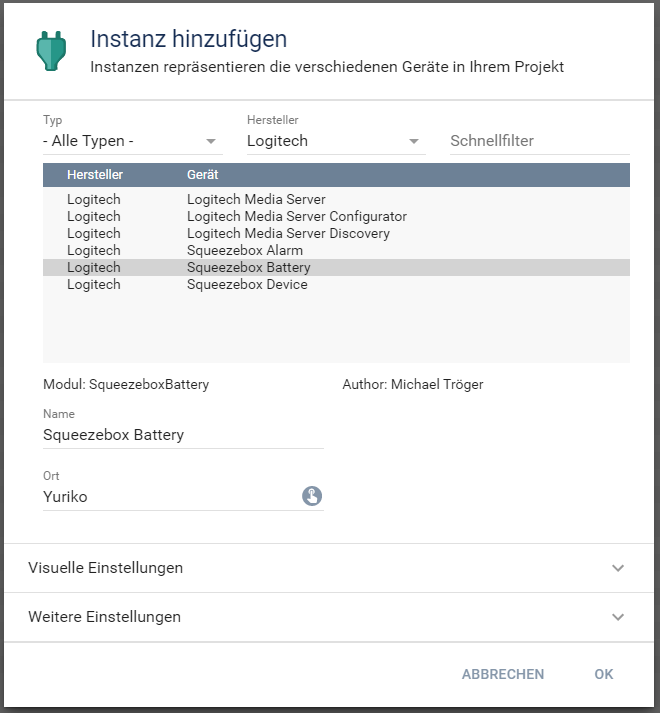
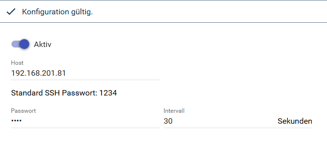
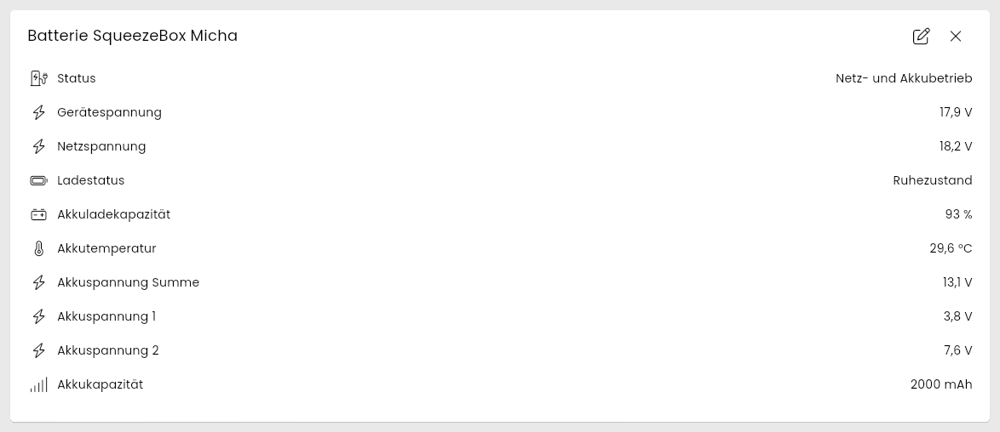
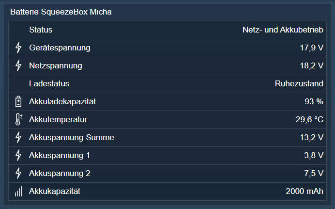
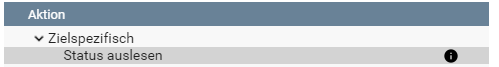

[](https://www.symcon.de/service/dokumentation/entwicklerbereich/sdk-tools/sdk-php/)
[](https://community.symcon.de/t/modul-squeezebox-release/46937)
[](https://www.symcon.de/de/service/dokumentation/installation/migrationen/)  
[](#10-lizenz)
[](https://github.com/Nall-chan/SqueezeBox/actions) [](https://github.com/Nall-chan/SqueezeBox/actions)  
[](#2-spenden)[](#2-spenden)  

# Squeezebox Battery  <!-- omit in toc -->

Daten zur Stromversorgung und des Akkus in IPS einbinden.  

## Inhaltsverzeichnis  <!-- omit in toc -->

- [1. Funktionsumfang](#1-funktionsumfang)
- [2. Voraussetzungen](#2-voraussetzungen)
- [3. Software-Installation](#3-software-installation)
- [4. Einrichten der Instanzen in IP-Symcon](#4-einrichten-der-instanzen-in-ip-symcon)
- [5. Statusvariablen](#5-statusvariablen)
- [6. Visualisierung](#6-visualisierung)
  - [Kachel Visualisierung](#kachel-visualisierung)
  - [WebFront Visualisierung](#webfront-visualisierung)
- [7. PHP-Befehlsreferenz](#7-php-befehlsreferenz)
- [8. Aktionen](#8-aktionen)
- [9. Anhang](#9-anhang)
  - [1. Changelog](#1-changelog)
  - [2. Spenden](#2-spenden)
- [10. Lizenz](#10-lizenz)

## 1. Funktionsumfang

- Auslesen und darstellen von Werten der Stromversorgung und des Akkumulators.  

## 2. Voraussetzungen

- Symcon ab Version 9.0
- kompatibler Player mit aktivierten SSH-Zugang  

## 3. Software-Installation

Dieses Modul ist Bestandteil der [SqueezeBox-Library](../README.md#3-software-installation).  

## 4. Einrichten der Instanzen in IP-Symcon

Eine einfache Einrichtung ist über den Konfigurator [Lyrion Music Server Konfigurator](../LMSConfigurator/README.md) möglich.  
Bei der manuellen Einrichtung ist die Instanz im Dialog `Instanz hinzufügen` unter dem Hersteller `Lyrion` zu finden.  
  

**Konfigurationsseite:**  

  

| Eigenschaft | Name     |   Typ   | Standardwert | Beschreibung                                                                                                                 |
| :---------- | :------- | :-----: | :----------- | :--------------------------------------------------------------------------------------------------------------------------- |
| Aktiv       | Active   | boolean | true         | Abfragen ein- bzw. ausschalten. Ausgeschaltet ist die Instanz inaktiv (`104`).                                               |
| Host        | Address  | string  |              | IP-Adresse oder Hostname der Squeezebox.                                                                                     |
| Passwort    | Password | string  | 1234         | Passwort des Benutzers `root` für den SSH-Zugang (Standard der Squeezebox Radio: `1234`).                                    |
| Intervall   | Interval | integer | 30           | Abfrageintervall in Sekunden. `0` = keine zyklische Abfrage (Instanz inaktiv), Werte von `1` bis `29` sind ungültig (`203`). |

**Beispiel:**  

```php
IPS_SetProperty(12345, 'Address', '192.168.1.50');
IPS_SetProperty(12345, 'Interval', 60);
IPS_ApplyChanges(12345);
```

Ist die Squeezebox nicht erreichbar oder schlägt die Anmeldung fehl, wechselt die Instanz in den Status `201` (Verbindung zum Gerät fehlgeschlagen). Die Statusvariablen behalten ihren letzten Wert. Die zyklische Abfrage schreibt den Fehler nur beim ersten Fehlschlag in Folge ins Log; nach der nächsten erfolgreichen Abfrage ist die Instanz wieder aktiv (`102`).  

## 5. Statusvariablen

Folgende Statusvariablen werden automatisch angelegt.

| Name               |   Typ   | Ident              | Beschreibung                                                                                                                                                  |
| :----------------- | :-----: | :----------------- | :------------------------------------------------------------------------------------------------------------------------------------------------------------ |
| Status             | integer | State              | Stromversorgung: `0`–`2` = offline, `3`–`4` = Netzbetrieb, `5`–`6` = Akkubetrieb, `7` = Netz- und Akkubetrieb.                                                |
| Gerätespannung     |  float  | SysVoltage         | Interne Gerätespannung in Volt.                                                                                                                               |
| Netzspannung       |  float  | WallVoltage        | Spannung vom Netzteil in Volt, im Akkubetrieb `0`.                                                                                                            |
| Ladestatus         | integer | ChargeState        | Akku: `1` = kein Akku, `2` = Ruhezustand, `3`–`7` = wird entladen, `8`–`24` = wird geladen, `25`–`34` = Ladezyklus pausiert, `35` = Warnung (Akku fast leer). |
| Akkuladekapazität  |  float  | BatteryLevel       | Ladestand in Prozent (gemeldete Restladung / Akkukapazität).                                                                                                  |
| Akkutemperatur     |  float  | BatteryTemperature | Temperatur des Akkus in °C.                                                                                                                                   |
| Akkuspannung Summe |  float  | BatteryVoltage     | Spannung des Akkus in Volt.                                                                                                                                   |
| Akkuspannung 1     |  float  | BatteryVMon1       | Spannung Messpunkt 1 in Volt.                                                                                                                                 |
| Akkuspannung 2     |  float  | BatteryVMon2       | Spannung Messpunkt 2 in Volt.                                                                                                                                 |
| Akkukapazität      | integer | BatteryCapacity    | Vom Gerät gemeldete Kapazität des Akkus in mAh.                                                                                                               |

Ohne Akku (`Ladestatus` = `1`) stehen alle Akku-Werte auf `0`.  

> [!NOTE]
> Die Werte stammen aus dem Mikrocontroller der Squeezebox Radio. Ladestand und `Ladestatus` folgen Squeezeplay ([`SqueezeboxBabyApplet.lua`](https://github.com/ralph-irving/squeezeplay/blob/master/src/squeezeplay_baby/share/applets/SqueezeboxBaby/SqueezeboxBabyApplet.lua), Copyright 2010 Logitech, BSD-Lizenz). Die Bereiche von `Status`, die Spannungen (Millivolt / 1000) und die Temperatur (1/32 °C) sind nicht dokumentiert und anhand von Live-Werten ermittelt.

## 6. Visualisierung

Die Instanz kann direkt oder über einen Link in der Visualisierung dargestellt werden.  

### Kachel Visualisierung

  

### WebFront Visualisierung

  

## 7. PHP-Befehlsreferenz

```php
bool LSQB_RequestState(int $InstanzID);
```

Aktuellen Status aus dem Gerät auslesen.  
Es wird `true` zurückgeben, wenn die Abfrage erfolgreich war, oder `false` im Fehlerfall. Dann erzeugt der Befehl einen Hinweis (Notice) mit der Fehlermeldung, auch wenn die zyklische Abfrage denselben Fehler schon gemeldet hat.  
Bei ausgeschalteter Instanz (`Aktiv` aus) liefert der Befehl ohne Hinweis `false`.  

## 8. Aktionen

**Grundsätzlich können alle bedienbaren Statusvariablen als Ziel einer [`Aktion`](https://www.symcon.de/service/dokumentation/konzepte/automationen/ablaufplaene/aktionen/) mit `Auf Wert schalten` angesteuert werden, so dass hier keine speziellen Aktionen benutzt werden müssen.**

Die Instanz besitzt keine bedienbaren Statusvariablen. Wenn eine `Squeezebox Battery` Instanz als Ziel einer Aktion ausgewählt wurde, steht folgende Aktion zur Verfügung:  

  

- Status aus dem Gerät auslesen

## 9. Anhang

### 1. Changelog

[Changelog der Library](../README.md#2-changelog)

### 2. Spenden

Die Library ist für die nicht kommerzielle Nutzung kostenlos, Schenkungen als Unterstützung für den Autor werden hier akzeptiert:  

PayPal:  
[](https://paypal.me/Nall4chan)  

Wunschliste:  
[](https://www.amazon.de/hz/wishlist/ls/YU4AI9AQT9F?ref_=wl_share)  

## 10. Lizenz

IPS-Modul:  
[Custom NC-SA](../LICENSE)  

Für die SSH-Verbindung ist [phpseclib](https://github.com/phpseclib/phpseclib) 2.0 eingebunden:  
Copyright (c) 2011-2019 TerraFrost (Jim Wigginton) and other contributors  
[MIT License](https://github.com/phpseclib/phpseclib/blob/2.0/LICENSE)  
